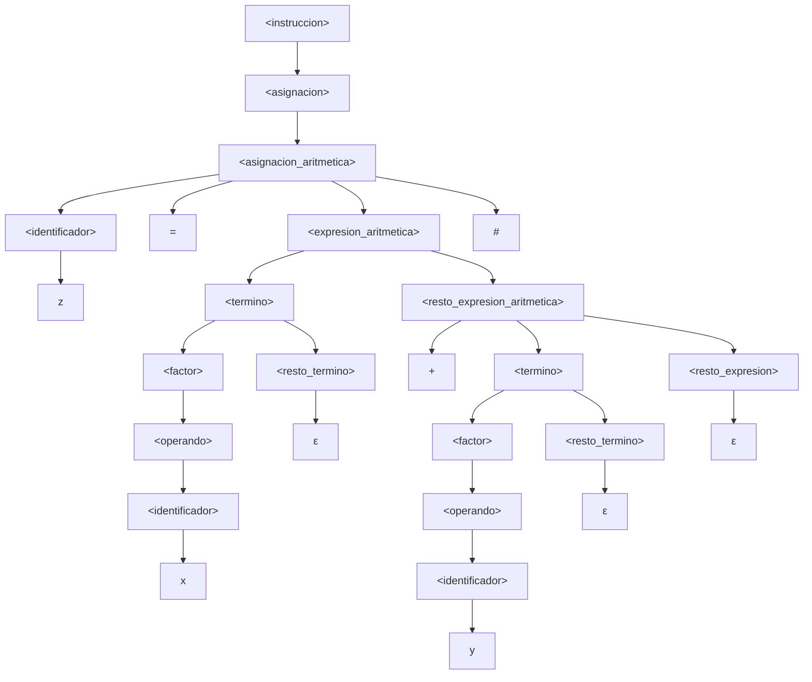
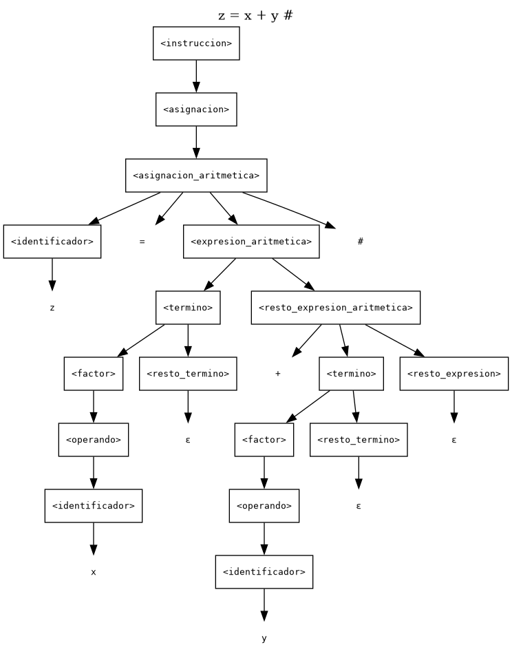

# Laboratorio 3 — Diseño y Validación de Gramáticas

**Asignatura:** Teoría de la Computación — INFO1148
**Tema:** Gramáticas Libres de Contexto (GLC)
**Modalidad:** Laboratorio práctico (parejas)
**Integrantes:** Francisco Benavides · Marcelo Matamala
**Docente:** Prof. M. Lévano
**Puntaje:** 100 puntos

**Artefactos de este repositorio**

| Artefacto | Ruta |
|---|---|
| Gramática en BNF numerada | [`gramatica/Lab3_gramatica.bnf`](../gramatica/Lab3_gramatica.bnf) |
| Validador (léxico + sintáctico) | [`gramatica/gramatica.py`](../gramatica/gramatica.py) |
| Evidencia de validación | [`gramatica/salidas/validacion.txt`](../gramatica/salidas/validacion.txt) |
| Árbol de `z = x + y #` | [`gramatica/salidas/arbol_z_igual_x_mas_y.txt`](../gramatica/salidas/arbol_z_igual_x_mas_y.txt) · [`.dot`](../gramatica/salidas/arbol_z_igual_x_mas_y.dot) · [`.mmd`](../gramatica/salidas/arbol_z_igual_x_mas_y.mmd) |
| Captura del árbol (PNG) | [`gramatica/salidas/arbol_z_igual_x_mas_y.png`](../gramatica/salidas/arbol_z_igual_x_mas_y.png) |

---

## 0. Correspondencia con la rúbrica

| Criterio de la rúbrica | Máx. | Dónde se responde | Evidencia verificable |
|---|---|---|---|
| **P1.** Identificación formal | 20 | §3 | Tablas §3.1–§3.2, definición §3.4, argumento §3.5 |
| **P2.** Construcción de la GLC | 30 | §4 | Producciones P1–P45, justificación §4.1–§4.5, verificación §4.6 |
| **P3.** Derivaciones y árbol | 25 | §5 | Derivaciones izquierdas §5.2–§5.3, árbol §5.4, explicación §5.5 |
| **P4.** Validación y errores | 25 | §6 | Tabla §6.1, análisis por caso §6.2, ejecución §6.3 |
| Coherencia interna | — | §5.7, §6.3 | Todas las cadenas se validan con el **mismo** parser que implementa la gramática |
| Notación | — | §3.4, §5.1 | BNF numerado + convención explícita de derivación |
| Justificación | — | §4.5, §6.2, §7.6 | Cada producción y cada caso tiene su explicación |
| Extensión creativa | — | §7 | Opción A (condicional) formalizada en P9 y P38–P45 y validada |
| Presentación | — | Todo el documento | Tablas, árbol gráfico y transcripción de la ejecución |

> **Nota metodológica.** No se presentan producciones "sueltas": la gramática está implementada en un analizador
> léxico–sintáctico (`gramatica.py`) que reproduce exactamente las producciones de §3.4. Todas las derivaciones,
> el árbol y la tabla de validación son coherentes con ese código, y su ejecución se transcribe en §6.3.

---

## 1. Objetivo

Diseñar, analizar y validar una **Gramática Libre de Contexto (GLC)** que represente la estructura sintáctica
de un lenguaje de programación simplificado, identificando sus componentes (terminales, no terminales y símbolo
inicial), construyendo las producciones, realizando derivaciones por la izquierda y comprobando la pertenencia de
cadenas válidas e inválidas.

**Alcance del trabajo.** La gramática cubre: estructura de programa, asignación simple, asignación con expresión
aritmética (con precedencia entre `* / %` y `+ -`), instrucción de salida, una o más instrucciones por programa y
comentarios. Como **extensión creativa** (Opción A) se agrega el condicional `si … entonces … fin_si`.

---

## 2. Lenguaje de referencia

```text
Begin
Programa operativo_01_02

x = 1.345 #
y = 20 #

/* operaciones y salidas */

z = x + y #
z2 = x + y #
h = z - x #
h2 = z - x #
k = h * y #
t = k / z #
m = k % 10 #

salida z #
salida h #
salida k #
salida t #
salida m #

temporal = 0 #
temporal = x #
x = y #
y = temporal #

salida x #
salida y #

End
```

Observaciones que guían el diseño:

1. `Begin` … `End` delimitan el programa y encierran **una o más** instrucciones.
2. `Programa` va seguido de un identificador (`operativo_01_02`), que admite letras, dígitos y `_`.
3. Cada instrucción termina en `#`; el `#` es obligatorio también en la última instrucción antes de `End`.
4. Hay dos formas de asignación: con un solo operando (`x = 1.345 #`) y con una operación (`z = x + y #`).
5. La instrucción de salida siempre imprime un identificador (`salida z #`), nunca un literal.
6. Aparece un comentario `/* … */` entre instrucciones.

---

## 3. Pregunta 1 — Identificación formal de la gramática (20 puntos)

### 3.1 Símbolos terminales

El alfabeto de la gramática es **finito** y está formado por *lexemas fijos* y por *clases de token* (que
representan conjuntos infinitos de lexemas):

**Σ = {** `Begin`, `End`, `Programa`, `salida`, `si`, `entonces`, `fin_si`,
`+`, `-`, `*`, `/`, `%`, `<`, `>`, `<=`, `>=`, `==`, `!=`, `=`, `#`, `ID`, `NUM`, `COMENT` **}**

| Categoría | Terminales | Descripción / patrón | Origen |
|---|---|---|---|
| **Palabras reservadas** | `Begin`, `End`, `Programa`, `salida` | Delimitan programa y marcan instrucciones. Son sensibles a mayúsculas tal como aparecen en el enunciado (`Begin`, `End`, `Programa` con mayúscula; `salida` en minúscula). | Núcleo |
| **Palabras reservadas (extensión)** | `si`, `entonces`, `fin_si` | Delimitan el condicional de la Opción A. | Extensión |
| **Operadores aritméticos** | `+`, `-`, `*`, `/`, `%` | Operaciones binarias entre operandos. | Núcleo |
| **Operadores relacionales (extensión)** | `<`, `>`, `<=`, `>=`, `==`, `!=` | Comparaciones usadas en la condición del `si`. | Extensión |
| **Símbolos especiales** | `=` | Operador de **asignación**. | Núcleo |
| | `#` | **Terminador de instrucción** (obligatorio, incluso en la última instrucción). | Núcleo |
| **Identificadores** | `ID` | `letra (letra \| dígito \| "_")*`, es decir, comienza con letra y luego admite letras, dígitos y guion bajo. Ej.: `x`, `y`, `temporal`, `operativo_01_02`, `z2`. | Núcleo |
| **Números** | `NUM` | `dígito+ ( "." dígito+ )?` — enteros o reales **positivos**, sin signo y sin punto final. Ej.: `0`, `20`, `10`, `1.345`. | Núcleo |
| **Comentarios** | `COMENT` | `/* … */`, tratado como **un solo token** (ver §4.7 y Anexo A). | Núcleo |

**Convención léxica.** Los espacios, tabuladores y saltos de línea **no pertenecen** al lenguaje: el analizador
léxico los descarta antes de aplicar las producciones (por eso el programa de referencia puede estar escrito en
varias líneas). El espacio en blanco no se incluye en Σ porque no aporta estructura sintáctica.

### 3.2 Símbolos no terminales

| No terminal | Función |
|---|---|
| `<programa>` | Unidad sintáctica completa: `Begin Programa <id> <instrucciones> End`. |
| `<lista_instrucciones>` | Inicio de la lista: comentarios opcionales (P2) seguidos de al menos una instrucción (P3). |
| `<resto_lista>` | Cola de la lista: más instrucciones, más comentarios o ε (P4–P6). |
| `<instruccion>` | Cualquier instrucción: asignación, salida o (extensión) condicional. |
| `<asignacion>` | Punto de decisión entre asignación simple y aritmética. |
| `<asignacion_simple>` | `<id> = <operando> #` (un único valor a la derecha). |
| `<asignacion_aritmetica>` | `<id> = <expresión con al menos un operador> #`. |
| `<expresion_aritmetica>` | Expresión que **obliga** a que exista al menos una operación; se divide en dos alternativas disjuntas (P14/P15). |
| `<resto_expresion_aritmetica>` | Cola de sumas/restas de nivel superior; exige al menos un `+` o `-` (P16/P17). |
| `<termino_aritmetico>` | Término que **obliga** a que exista al menos un `*`, `/` o `%` (P18). |
| `<resto_termino_aritmetico>` | Cola multiplicativa que exige al menos un `*`, `/` o `%` (P19–P21). |
| `<expresion>` | Expresión aditiva del núcleo: términos separados por `+` o `-` (P22–P25). |
| `<resto_expresion>` | Cola recursiva de `<expresion>` (o ε). |
| `<termino>` | Expresión multiplicativa del núcleo: factores separados por `*`, `/` o `%` (P26–P30). |
| `<resto_termino>` | Cola recursiva de `<termino>` (o ε). |
| `<factor>` | Unidad mínima de una expresión (P31). |
| `<operando>` | Identificador o número (P32/P33). |
| `<salida>` | `salida <id> #`. |
| `<identificador>` | Enlace con la clase léxica `ID`. |
| `<numero>` | Enlace con la clase léxica `NUM`. |
| `<comentario>` | Enlace con la clase léxica `COMENT`. |
| `<condicional>` | (Extensión) `si <condición> entonces <instrucciones> fin_si`. |
| `<condicion>` | (Extensión) `<expresión> <op_relacional> <expresión>`. |
| `<operador_relacional>` | (Extensión) Agrupa los seis operadores relacionales. |

**V = {** `<programa>`, `<lista_instrucciones>`, `<resto_lista>`, `<instruccion>`, `<asignacion>`,
`<asignacion_simple>`, `<asignacion_aritmetica>`, `<expresion_aritmetica>`, `<resto_expresion_aritmetica>`,
`<termino_aritmetico>`, `<resto_termino_aritmetico>`, `<expresion>`, `<resto_expresion>`, `<termino>`,
`<resto_termino>`, `<factor>`, `<operando>`, `<salida>`, `<identificador>`, `<numero>`, `<comentario>`,
`<condicional>`, `<condicion>`, `<operador_relacional>` **}** → **|V| = 24**.

### 3.3 Símbolo inicial

**S = `<programa>`**. Es el único no terminal que produce un programa completo (desde `Begin` hasta `End`), por
lo que toda cadena del lenguaje debe derivarse a partir de él.

### 3.4 Definición formal de la gramática

> **G = (V, Σ, P, S)**, donde `V` y `Σ` son los conjuntos de §3.1 y §3.2, `S = <programa>` y `P` es el conjunto
> de las **45 producciones** que siguen: **36 del núcleo** (P1–P8 y P10–P37) y **9 de la extensión**
> (P9 y P38–P45).

Notación: `ε` denota la producción vacía; cada producción se numera (`P#`) para referenciarla en las derivaciones.

| # | Producción | # | Producción |
|---|---|---|---|
| **P1** | `<programa> → Begin Programa <identificador> <lista_instrucciones> End` | **P23** | `<resto_expresion> → + <termino> <resto_expresion>` |
| **P2** | `<lista_instrucciones> → <comentario> <lista_instrucciones>` | **P24** | `<resto_expresion> → - <termino> <resto_expresion>` |
| **P3** | `<lista_instrucciones> → <instruccion> <resto_lista>` | **P25** | `<resto_expresion> → ε` |
| **P4** | `<resto_lista> → <instruccion> <resto_lista>` | **P26** | `<termino> → <factor> <resto_termino>` |
| **P5** | `<resto_lista> → <comentario> <resto_lista>` | **P27** | `<resto_termino> → * <factor> <resto_termino>` |
| **P6** | `<resto_lista> → ε` | **P28** | `<resto_termino> → / <factor> <resto_termino>` |
| **P7** | `<instruccion> → <asignacion>` | **P29** | `<resto_termino> → % <factor> <resto_termino>` |
| **P8** | `<instruccion> → <salida>` | **P30** | `<resto_termino> → ε` |
| **P9** | `<instruccion> → <condicional>` ⟵ *ext.* | **P31** | `<factor> → <operando>` |
| **P10** | `<asignacion> → <asignacion_simple>` | **P32** | `<operando> → <identificador>` |
| **P11** | `<asignacion> → <asignacion_aritmetica>` | **P33** | `<operando> → <numero>` |
| **P12** | `<asignacion_simple> → <identificador> = <operando> #` | **P34** | `<salida> → salida <identificador> #` |
| **P13** | `<asignacion_aritmetica> → <identificador> = <expresion_aritmetica> #` | **P35** | `<identificador> → ID` |
| **P14** | `<expresion_aritmetica> → <termino> <resto_expresion_aritmetica>` | **P36** | `<numero> → NUM` |
| **P15** | `<expresion_aritmetica> → <termino_aritmetico>` | **P37** | `<comentario> → COMENT` |
| **P16** | `<resto_expresion_aritmetica> → + <termino> <resto_expresion>` | **P38** | `<condicional> → si <condicion> entonces <lista_instrucciones> fin_si` ⟵ *ext.* |
| **P17** | `<resto_expresion_aritmetica> → - <termino> <resto_expresion>` | **P39** | `<condicion> → <expresion> <operador_relacional> <expresion>` ⟵ *ext.* |
| **P18** | `<termino_aritmetico> → <factor> <resto_termino_aritmetico>` | **P40** | `<operador_relacional> → <` ⟵ *ext.* |
| **P19** | `<resto_termino_aritmetico> → * <factor> <resto_termino>` | **P41** | `<operador_relacional> → >` ⟵ *ext.* |
| **P20** | `<resto_termino_aritmetico> → / <factor> <resto_termino>` | **P42** | `<operador_relacional> → <=` ⟵ *ext.* |
| **P21** | `<resto_termino_aritmetico> → % <factor> <resto_termino>` | **P43** | `<operador_relacional> → >=` ⟵ *ext.* |
| **P22** | `<expresion> → <termino> <resto_expresion>` | **P44** | `<operador_relacional> → ==` ⟵ *ext.* |
| | | **P45** | `<operador_relacional> → !=` ⟵ *ext.* |

La misma gramática, en formato BNF listo para copiar en otra herramienta, está en
[`gramatica/Lab3_gramatica.bnf`](../gramatica/Lab3_gramatica.bnf).

### 3.5 ¿Por qué no modelar identificadores y números enumerando cada valor?

Porque ambos conjuntos son **infinitos** y una gramática es un objeto **finito**:

1. **`P` sería infinita.** Habría que escribir `x → …`, `y → …`, `temporal → …`, `a1 → …`, para cada nombre
   posible; lo mismo con `0`, `1`, `2`, … y con todos los reales. Ninguna herramienta (ni JFLAP) podría almacenar
   ni procesar ese conjunto de producciones.
2. **No generaliza.** Un programa que use un identificador nuevo (`contador_02`) quedaría fuera del lenguaje
   aunque sea sintácticamente idéntico a uno ya enumerado: la gramática describiría una lista cerrada de
   programas, no un **lenguaje**.
3. **Separa responsabilidades.** Los identificadores y números se reconocen con reglas **regulares**
   (Anexo A): un autómata finito decide si una cadena de caracteres es `ID` o `NUM`. La GLC trabaja entonces
   sobre *tokens*, y cada clase (`ID`, `NUM`, `COMENT`) es **un** terminal. Así se mantiene Σ finito y `P` finito,
   que es justamente lo que exige la definición de gramática.
4. **Efecto práctico.** Gracias a esa abstracción, `x = 20 #` y `operativo_01_02 = 1.345 #` se derivan con las
   **mismas** producciones (P10, P12, P32/P33, P35/P36); solo cambia el lexema asociado al token.

---

## 4. Pregunta 2 — Construcción de la GLC (30 puntos)

### 4.1 Estructura del programa (P1–P6)

```bnf
<programa>            → Begin Programa <identificador> <lista_instrucciones> End
<lista_instrucciones> → <comentario> <lista_instrucciones>
                      | <instruccion> <resto_lista>
<resto_lista>         → <instruccion> <resto_lista>
                      | <comentario> <resto_lista>
                      | ε
```

- **P1** fija el esqueleto exigido por el enunciado: `Begin Programa <id> <lista> End`. El identificador del
  programa es obligatorio (en el ejemplo, `operativo_01_02`).
- **P2** permite comentarios **antes** de la primera instrucción, pero no permite cerrar la lista: tras un
  comentario se vuelve a exigir una `<lista_instrucciones>`, que solo puede completarse, tras cero o más
  comentarios, con P3.
- **P3** garantiza que exista **al menos una instrucción**: produce `<instruccion> <resto_lista>`.
- **P4/P5** permiten agregar más instrucciones o comentarios **entre** instrucciones y **después** de la última.
- **P6** cierra la lista con ε. Gracias a P3, la lista nunca queda vacía; gracias a P4/P5, un comentario final
  antes de `End` o de `fin_si` sí es válido.

En consecuencia, se admiten comentarios antes, entre y después de las instrucciones, pero **no** un programa
(ni un cuerpo de condicional) que contenga solo comentarios. Esa restricción se conserva porque **P2 no tiene
alternativa ε**: tras un comentario inicial se vuelve a exigir una `<lista_instrucciones>`, que solo puede
completarse con P3. En cambio, **P5 sí puede terminar en P6** una vez que ya existe una instrucción; eso es lo
que permite los comentarios finales antes de `End` o de `fin_si`.

### 4.2 Asignación simple vs. asignación con expresión aritmética (P10–P15)

```bnf
<asignacion>            → <asignacion_simple> | <asignacion_aritmetica>
<asignacion_simple>     → <identificador> = <operando> #
<asignacion_aritmetica> → <identificador> = <expresion_aritmetica> #
<expresion_aritmetica>  → <termino> <resto_expresion_aritmetica>
                        | <termino_aritmetico>
```

La diferencia es **estructural, no semántica**:

| Forma | Ejemplo | Producciones | Rasgo que la distingue |
|---|---|---|---|
| **Asignación simple** | `x = 20 #`, `temporal = x #` | P10 → P12 → P32/P33 | El lado derecho es **un solo operando**: no hay ningún operador aritmético. |
| **Asignación con expresión** | `z = x + y #`, `m = k % 10 #` | P11 → P13 → P14/P15 | El lado derecho **contiene al menos un operador**. P14 exige una suma/resta de nivel superior; P15 exige un producto/división/módulo. |

**¿Por qué no hay ambigüedad?** La frontera entre “simple” y “aritmética” es única:

1. P12 termina en `#` inmediatamente después de un operando; P13 exige una `<expresion_aritmetica>`, que por
   P14/P15 siempre contiene al menos un operador. Por tanto, tras `id = operando` el siguiente token decide:
   `#` → P12; un operador → P13.
2. Dentro de `<expresion_aritmetica>`, P14 y P15 son **disjuntas por el operador de nivel superior**:
   - P14 usa `<resto_expresion_aritmetica>`, que solo produce `+` o `-` (P16/P17);
   - P15 usa `<termino_aritmetico>`, que solo produce `*`, `/` o `%` (P18–P21).
   Una expresión como `x + y` no puede derivarse por P15 (no tiene operador multiplicativo) y una como `x * y`
   no puede derivarse por P14 (no tiene suma/resta). El analizador implementa esta misma decisión con
   `hay_suma_en_expresion()`: si hay un `+`/`-` de nivel superior usa P14; si solo hay `*`/`/`/`%`, usa P15.
3. Si se hubiera escrito una única producción `<asignacion> → <id> = <expresion> #`, donde `<expresion>` admite
   un solo operando, `x = 20 #` tendría **dos árboles** (vía simple y vía aritmética) y la gramática sería
   ambigua. Por eso se separan P12 y P13, y por eso la expresión aritmética obliga a contener un operador.

### 4.3 Instrucción de salida (P34)

```bnf
<salida> → salida <identificador> #
```

`salida` imprime **solo identificadores** (`salida z #`), tal como muestra el programa de referencia; no se admite
`salida 20 #` ni `salida x + y #`. El `#` es obligatorio: `salida z` no es una instrucción.

### 4.4 Expresiones, precedencia y recursión (P14–P31)

La gramática separa dos niveles:

1. **Bloque aritmético de asignación (P14–P21).** Se usa solo en el lado derecho de una asignación aritmética y
   **garantiza que exista al menos un operador**:
   - P14: `<expresion_aritmetica> → <termino> <resto_expresion_aritmetica>`, para expresiones con `+` o `-` de
     nivel superior. P16/P17 obligan a que aparezca al menos uno de esos operadores.
   - P15: `<expresion_aritmetica> → <termino_aritmetico>`, para expresiones que solo tienen `*`, `/` o `%`.
     P18 y P19–P21 obligan a que aparezca al menos uno de esos operadores.
2. **Expresiones del núcleo (P22–P31).** Son las que aportan la jerarquía de precedencia y se reutilizan en las
   condiciones de la extensión:
   - `<expresion> → <termino> <resto_expresion>` (P22), con `+`/`-` en P23/P24 y ε en P25.
   - `<termino> → <factor> <resto_termino>` (P26), con `*`, `/`, `%` en P27–P29 y ε en P30.
   - `<factor> → <operando>` (P31), y `<operando> → <identificador> | <numero>` (P32/P33).

La jerarquía codifica la **precedencia**:

```text
        menor precedencia  ─────────────────────────►  mayor precedencia
   <expresion>  (+ -)   →   <termino>  (* / %)   →   <factor>   →   <operando>
```

- `+` y `-` se combinan en `<resto_expresion>` (P23/P24), que solo contiene términos.
- `*`, `/` y `%` se combinan en `<resto_termino>` (P27–P29), que solo contiene factores.
- Consecuencia: en `a + b * c` el `*` queda **más abajo** en el árbol (se evalúa primero), porque `b * c` se
  deriva dentro de un `<termino>`; mientras que en `a * b + c` la suma queda en la raíz de la expresión.
- Las producciones ε (P25, P30) son las que permiten que una expresión termine; sin ellas la recursión nunca
  cerraría y solo se podrían generar cadenas infinitas.

> **Observación sobre asociatividad.** Al ser recursivas por la derecha, P16/P17 (y también P23/P24) producen
> árboles `a - (b - c)` para `a - b - c`. El **lenguaje generado es el mismo** que con producciones recursivas
> por la izquierda (`<expresion> → <expresion> + <termino> | <expresion> - <termino> | <termino>`), que daría
> `(a - b) - c`. Se eligió la forma recursiva por la derecha porque las derivaciones por la izquierda son más
> legibles y el árbol es más fácil de dibujar; la asociatividad semántica no forma parte de lo evaluado en este
> laboratorio (el enunciado no incluye paréntesis ni evaluación).

### 4.5 Función de cada no terminal (justificación)

| No terminal | Por qué existe / qué aporta | Ejemplo que lo ejercita |
|---|---|---|
| `<programa>` | Aísla el esqueleto `Begin … End` y da un símbolo inicial único. | Programa completo. |
| `<lista_instrucciones>` | Inicia la lista con al menos una instrucción (P3), admitiendo comentarios previos (P2). | `/* inicial */ x = 1 #`. |
| `<resto_lista>` | Continúa la lista con más instrucciones (P4), más comentarios (P5) o la cierra con ε (P6). | `x = 1 # /* final */`. |
| `<instruccion>` | Uniformiza el contenido de la lista y concentra la decisión entre asignación, salida y condicional (P7–P9). | `x = 1 #`, `salida x #`, `si …`. |
| `<asignacion>` | Separa la decisión simple/aritmética del resto (P10/P11). | `x = 1 #` vs. `x = 1 + 2 #`. |
| `<asignacion_simple>` | Reconoce asignaciones de un solo valor (P12). | `temporal = x #`. |
| `<asignacion_aritmetica>` | Reconoce asignaciones con al menos una operación (P13). | `z = x + y #`. |
| `<expresion_aritmetica>` | Obliga a que exista al menos un operador; sin ella no se podría distinguir la asignación simple. | `x + y`, `k % 10`. |
| `<resto_expresion_aritmetica>` | Aporta el primer `+`/`-` de nivel superior y encadena el resto con `<resto_expresion>` (P16/P17). | `x + y + z`. |
| `<termino_aritmetico>` | Aporta al menos un `*`, `/` o `%` cuando no hay sumas/restas (P18). | `a * b`, `k % 10`. |
| `<resto_termino_aritmetico>` | Encadena los operadores multiplicativos y exige al menos uno (P19–P21). | `a * b / c`. |
| `<expresion>` | Nivel aditivo del núcleo: agrupa términos con `+`/`-` (P22–P25). | `z - x`, `a + b * c`. |
| `<resto_expresion>` | Recursión del nivel aditivo y caso base ε (P23–P25). | `x + y + z`. |
| `<termino>` | Nivel multiplicativo del núcleo: agrupa factores con `*`, `/`, `%` (P26–P30). | `h * y`, `k / z`. |
| `<resto_termino>` | Recursión del nivel multiplicativo y caso base ε (P27–P30). | `a * b / c`. |
| `<factor>` | Unidad de la expresión; permite ampliar el lenguaje (p. ej. paréntesis) sin tocar los demás niveles (P31). | `10`, `x`. |
| `<operando>` | Único punto donde se elige entre identificador y número (P32/P33). | `x`, `1.345`. |
| `<salida>` | Estructura propia de impresión (P34). | `salida z #`. |
| `<identificador>` | Enlace con el token `ID`; mantiene la gramática independiente de los lexemas concretos (P35). | `operativo_01_02`. |
| `<numero>` | Enlace con el token `NUM` (enteros y reales) (P36). | `1.345`. |
| `<comentario>` | Enlace con el token `COMENT`; permite comentarios sin contaminar las instrucciones (P37). | `/* … */`. |
| `<condicional>` | (Ext.) Estructura de control con condición y bloque propio (P38). | `si x > 10 entonces … fin_si`. |
| `<condicion>` | (Ext.) Separa la condición del bloque para que sea reutilizable (P39). | `x > 10`. |
| `<operador_relacional>` | (Ext.) Agrupa las seis comparaciones (P40–P45). | `>=`, `!=`. |

### 4.6 ¿La gramática representa el programa de referencia completo?

**Sí.** El programa de §2, con sus 20 instrucciones y su comentario, se deriva desde `<programa>` aplicando
P1, P2/P3/P4/P5/P6 (estructura de la lista), P7/P8 (tipo de instrucción; P9 solo en la extensión),
P12/P13 (asignación) y P34 (salida). La verificación no es declarativa: el validador lo procesa y responde
**ACEPTADO**, contando los elementos reconocidos:

| Elemento del programa | Producción aplicada | Cantidad detectada |
|---|---|---|
| `Begin` … `End` con identificador | P1 + P35 | 1 programa (`operativo_01_02`) |
| Asignaciones simples (`x = 1.345 #`, `y = 20 #`, `temporal = 0 #`, `temporal = x #`, `x = y #`, `y = temporal #`) | P10, P12, P32/P33, P35/P36 | **6** |
| Asignaciones aritméticas (`z`, `z2`, `h`, `h2`, `k`, `t`, `m`) | P11, P13, P14/P15 | **7** |
| Salidas (`z`, `h`, `k`, `t`, `m`, `x`, `y`) | P34 + P35 | **7** |
| Comentario `/* operaciones y salidas */` | P5 + P37 | **1** |
| **Total de elementos de la lista** | P2–P6 | **21** |

Los números coinciden con el programa: 20 instrucciones + 1 comentario = 21 elementos. Además, los números
`1.345` (real) y `20`, `0`, `10` (enteros) se aceptan con la misma clase `NUM` (P36), lo que confirma que no hace
falta enumerar valores. El árbol completo exportado en
[`arbol_programa_referencia.dot`](../gramatica/salidas/arbol_programa_referencia.dot) incluye los nodos
`<resto_lista>` de P3–P6.

### 4.7 Propiedades, alcance y limitaciones

1. **No ambigüedad (argumento estructural).** Cada nivel de la jerarquía tiene producciones disjuntas por su
   primer terminal o por el operador de nivel superior: P12 termina en `#` tras un operando, mientras que P13
   exige una expresión con al menos un operador; dentro de esta, P14 y P15 se distinguen porque P16/P17 exigen
   `+`/`-` y P19–P21 exigen `*`/`/`/`%`. En `<lista_instrucciones>`, P2 empieza por `COMENT` y P3 por un token
   de instrucción (`ID`, `salida`, `si`); en `<resto_lista>`, P4 empieza por instrucción, P5 por `COMENT` y P6
   es ε (se aplica al ver `End`, `fin_si` o el fin de la entrada). No hay producciones alternativas que puedan
   generar la misma cadena y el análisis es determinista por el siguiente token. Por lo tanto cada cadena tiene
   un único árbol de derivación.
2. **Comentarios como token.** Un comentario puede contener cualquier carácter, incluso `Begin` o `#`.
   Modelarlo carácter por carácter exigiría producciones para todo el alfabeto y no aporta estructura
   sintáctica: se reconoce con la regla regular `COMENT` (Anexo A) y la GLC lo ve como un único símbolo
   terminal, igual que `ID` y `NUM`. Se admiten **antes** (P2), **entre** (P5) y **después** (P5) de las
   instrucciones. No se admite un programa ni un cuerpo de condicional formado **solo** por comentarios:
   P2 no tiene alternativa ε, por lo que tras un comentario inicial siempre se exige una lista que desemboque
   en una instrucción (P3). En cambio, P5 puede terminar en P6 una vez que ya existe al menos una instrucción;
   de ahí que un comentario final antes de `End` o de `fin_si` sí sea válido.
3. **Sin paréntesis ni signos.** El lenguaje del enunciado no los incluye; por eso `<factor>` solo admite un
   operando. Añadirlos sería una extensión natural (`<factor> → ( <expresion> )`), pero cambiaría el lenguaje
   solicitado.
4. **Números positivos.** `-5` no es un `NUM`: el `-` es un operador binario. `1.` tampoco es válido (la parte
   decimal exige al menos un dígito), lo que el analizador léxico reporta como error.
5. **Mayúsculas.** Las palabras reservadas son sensibles a mayúsculas: `Begin`/`End`/`Programa` con mayúscula
   inicial y `salida` en minúscula, tal como aparecen en el enunciado. `begin` sería un identificador, no una
   palabra reservada.

---

## 5. Pregunta 3 — Derivaciones y árbol sintáctico (25 puntos)

### 5.1 Convención de notación

- `⇒` : una derivación en un paso (aplicación de **una** producción al no terminal **más a la izquierda**).
- `⇒*` : derivación en cero o más pasos.
- `ε` : cadena vacía; al final de una derivación no aporta símbolos a la forma sentencial.
- Para no inflar las tablas, la expansión de las clases léxicas se abrevia: `<identificador> ⇒ z` significa
  `<identificador> ⇒ ID ⇒ z` (P35 y reconocimiento léxico). El Anexo A muestra la expansión completa carácter por
  carácter de un identificador y de un número real.
- Se indica entre paréntesis la producción aplicada; los números remiten a la tabla de §3.4.

### 5.2 Derivación por la izquierda de `z = x + y #`

| Paso | Forma sentencial | Producción |
|---:|---|---|
| 0 | `<instruccion>` | — |
| 1 | `<asignacion>` | P7 |
| 2 | `<asignacion_aritmetica>` | P11 |
| 3 | `<identificador> = <expresion_aritmetica> #` | P13 |
| 4 | `z = <expresion_aritmetica> #` | P35 (léxica) |
| 5 | `z = <termino> <resto_expresion_aritmetica> #` | P14 |
| 6 | `z = <factor> <resto_termino> <resto_expresion_aritmetica> #` | P26 |
| 7 | `z = <operando> <resto_termino> <resto_expresion_aritmetica> #` | P31 |
| 8 | `z = <identificador> <resto_termino> <resto_expresion_aritmetica> #` | P32 |
| 9 | `z = x <resto_termino> <resto_expresion_aritmetica> #` | P35 (léxica) |
| 10 | `z = x ε <resto_expresion_aritmetica> #` | P30 |
| 11 | `z = x ε + <termino> <resto_expresion> #` | P16 |
| 12 | `z = x ε + <factor> <resto_termino> <resto_expresion> #` | P26 |
| 13 | `z = x ε + <operando> <resto_termino> <resto_expresion> #` | P31 |
| 14 | `z = x ε + <identificador> <resto_termino> <resto_expresion> #` | P32 |
| 15 | `z = x ε + y <resto_termino> <resto_expresion> #` | P35 (léxica) |
| 16 | `z = x ε + y ε <resto_expresion> #` | P30 |
| 17 | `z = x ε + y ε ε #` | P25 |
| 18 | **`z = x + y #`** | ε no aporta símbolos |

Resultado: `<instruccion> ⇒* z = x + y #`. ✔

### 5.3 Derivación por la izquierda de `salida z #`

| Paso | Forma sentencial | Producción |
|---:|---|---|
| 0 | `<instruccion>` | — |
| 1 | `<salida>` | P8 |
| 2 | `salida <identificador> #` | P34 |
| 3 | **`salida z #`** | P35 (léxica) |

Resultado: `<instruccion> ⇒* salida z #`. ✔

### 5.4 Árbol de derivación de `z = x + y #`

Árbol generado automáticamente por el analizador (por lo tanto, **consistente con la gramática**). Puede
abrirse en cualquier visor de Mermaid o renderizarse desde
[`arbol_z_igual_x_mas_y.dot`](../gramatica/salidas/arbol_z_igual_x_mas_y.dot) con Graphviz; no se requiere JFLAP.



**Versión textual** (idéntica al archivo [`arbol_z_igual_x_mas_y.txt`](../gramatica/salidas/arbol_z_igual_x_mas_y.txt)):

```text
<instruccion>
└── <asignacion>
    └── <asignacion_aritmetica>
        ├── <identificador>
        │   └── z
        ├── =
        ├── <expresion_aritmetica>
        │   ├── <termino>
        │   │   ├── <factor>
        │   │   │   └── <operando>
        │   │   │       └── <identificador>
        │   │   │           └── x
        │   │   └── <resto_termino>
        │   │       └── ε
        │   └── <resto_expresion_aritmetica>
        │       ├── +
        │       ├── <termino>
        │       │   ├── <factor>
        │       │   │   └── <operando>
        │       │   │       └── <identificador>
        │       │   │           └── y
        │       │   └── <resto_termino>
        │       │       └── ε
        │       └── <resto_expresion>
        │           └── ε
        └── #
```

**Captura renderizada** (evidencia gráfica; también en
[`../gramatica/salidas/arbol_z_igual_x_mas_y.png`](../gramatica/salidas/arbol_z_igual_x_mas_y.png)):



### 5.5 Relación entre raíz, no terminales, terminales y hojas

- **Raíz:** es el símbolo inicial de la derivación, `<instruccion>` en este caso. Si el árbol se construye dentro
  de un programa completo, la raíz sería `<programa>` (el símbolo inicial `S` de la gramática). La raíz fija *qué*
  se está derivando; aquí se derivó una instrucción porque la cadena pedida es una instrucción suelta (§5.7
  muestra la derivación desde `<programa>`).
- **Nodos internos = no terminales:** cada nodo interno es un símbolo de `V` y corresponde a una producción
  aplicada. Por ejemplo, `<asignacion_aritmetica>` (n2) existe porque se aplicó P13: sus hijos sintácticos son
  `<identificador>`, `=` y `<expresion_aritmetica>` (más el `#`). A su vez, `<expresion_aritmetica>` (n6) aplicó
  P14 y tiene dos hijos: `<termino>` (n7) y `<resto_expresion_aritmetica>` (n14). Este último aplicó P16 y aporta
  el `+`, el segundo `<termino>` y el `<resto_expresion>` final.
- **Hojas = terminales:** las hojas son símbolos de Σ (`z`, `=`, `x`, `+`, `y`, `#`) o ε. Leídas de izquierda a
  derecha reconstruyen **exactamente** la cadena derivada. La secuencia de hojas se denomina *fronda*:
  `z = x + y #`.
- **ε no se escribe:** los nodos `<resto_termino> → ε` (P30) y `<resto_expresion> → ε` (P25) son hojas que no
  aportan caracteres; están en el árbol porque explicitan que la recursión terminó (caso base).
- **Correspondencia con la derivación:** el árbol es la historia de la derivación. Cada nivel del árbol
  corresponde a un paso de §5.2, y el orden en que se expandieron los no terminales de izquierda a derecha es
  precisamente la derivación por la izquierda. La profundidad del árbol refleja la jerarquía de precedencia:
  `+` está en `<resto_expresion_aritmetica>`, por encima de los `<termino>` donde se alojarían `*`, `/` o `%`.

### 5.6 Pertenencia de las cadenas solicitadas

| Cadena | ¿Se genera? | Derivación (esquema) | Justificación |
|---|---|---|---|
| `x = 20 #` | **Sí** | `<instruccion> ⇒ <asignacion> ⇒ <asignacion_simple> ⇒ <identificador> = <operando> # ⇒ x = <numero> # ⇒ x = 20 #` (P7, P10, P12, P35, P33, P36) | El lado derecho es **un solo operando** (un número entero): se aplica la vía simple, no la aritmética. |
| `z = x * y #` | **Sí** | `<instruccion> ⇒ <asignacion> ⇒ <asignacion_aritmetica> ⇒ <identificador> = <expresion_aritmetica> # ⇒ z = <expresion_aritmetica> # ⇒ z = <termino_aritmetico> # ⇒ z = <factor> <resto_termino_aritmetico> # ⇒ z = <operando> <resto_termino_aritmetico> # ⇒ z = <identificador> <resto_termino_aritmetico> # ⇒ z = x <resto_termino_aritmetico> # ⇒ z = x * <factor> <resto_termino> # ⇒ z = x * <operando> <resto_termino> # ⇒ z = x * <identificador> <resto_termino> # ⇒ z = x * y <resto_termino> # ⇒ z = x * y ε # ⇒ z = x * y #` (P7, P11, P13, P35, P15, P18, P31, P32, P35, P19, P31, P32, P35, P30) | `*` obliga a usar P15/P19 (expresión solo multiplicativa); P30 cierra la recursión. |
| `salida temporal #` | **Sí** | `<instruccion> ⇒ <salida> ⇒ salida <identificador> # ⇒ salida temporal #` (P8, P34, P35) | `temporal` es un `ID` válido (letras y sin caracteres prohibidos); P34 no impone longitud al identificador. |

Las tres derivaciones fueron verificadas por el validador: las tres se aceptan (§6.3).

### 5.7 Coherencia con el símbolo inicial (derivación desde `<programa>`)

Para mostrar que la instrucción de §5.2 no es un caso aislado, se deriva el programa mínimo que la contiene,
`Begin Programa p z = x + y # End`:

```text
<programa>
⇒ Begin Programa <identificador> <lista_instrucciones> End        (P1)
⇒ Begin Programa p <lista_instrucciones> End                      (P35)
⇒ Begin Programa p <instruccion> <resto_lista> End                (P3)
⇒ Begin Programa p <asignacion> <resto_lista> End                 (P7)
⇒ Begin Programa p <asignacion_aritmetica> <resto_lista> End      (P11)
⇒ Begin Programa p <identificador> = <expresion_aritmetica> # <resto_lista> End (P13)
⇒ Begin Programa p z = <expresion_aritmetica> # <resto_lista> End (P35)
⇒ … (pasos 5–17 de §5.2) …
⇒ Begin Programa p z = x + y # <resto_lista> End
⇒ Begin Programa p z = x + y # End                                (P6)
```

El mismo puente desde `S` para `salida z #` es:

```text
<programa>
⇒ Begin Programa <identificador> <lista_instrucciones> End        (P1)
⇒ Begin Programa p <lista_instrucciones> End                      (P35)
⇒ Begin Programa p <instruccion> <resto_lista> End                (P3)
⇒ Begin Programa p <salida> <resto_lista> End                     (P8)
⇒ Begin Programa p salida <identificador> # <resto_lista> End     (P34)
⇒ Begin Programa p salida z # <resto_lista> End                   (P35)
⇒ Begin Programa p salida z # End                                 (P6)
```

Con P4 en `<resto_lista>` se agregan más instrucciones; con P5, más comentarios; con P6 se cierra la lista.
Ese es el mismo esquema que genera el programa de referencia completo de §2.

---

## 6. Pregunta 4 — Validación y detección de errores (25 puntos)

### 6.1 Tabla de análisis

| Caso | Cadena | ¿Válida? | Token donde se detecta el problema | Elemento faltante o fuera de posición |
|---:|---|:---:|---|---|
| 1 | `x = 10 #` | **Sí** | — | — |
| 2 | `z = x + y #` | **Sí** | — | — |
| 3 | `salida z #` | **Sí** | — | — |
| 4 | `x 10 #` | **No** | `NUM` `10` (col. 3) | **Falta `=`** entre el identificador y el número (P12 exige `<identificador> = <operando> #`). |
| 5 | `z=+xy#` | **No** | `OP_ARIT` `+` (col. 3) | El operador `+` está **al inicio de la expresión**: falta el operando de la izquierda. P14/P15 exigen que la expresión empiece por `<termino>`/`<termino_aritmetico>`, y el lenguaje no tiene operadores unarios. |
| 6 | `salida #` | **No** | `HASH` `#` (col. 8) | **Falta el `<identificador>`** que se desea imprimir (P34 exige `salida <identificador> #`). |
| 7 | `x = 20` | **No** | `EOF` (col. 7) | **Falta el terminador `#`** al final de la instrucción (P12/P13). |
| 8 | `Begin / Programa prueba / x = 5 # / salida x # / End` | **Sí** | — | — (los `/` representan los saltos de línea; el espacio en blanco no pertenece a Σ). |

Los casos 2 y 8 se muestran con espacios o `/` por legibilidad; el espacio no pertenece a Σ. El caso 5 se
conserva exactamente como `z=+xy#` porque separarlo cambiaría los tokens (`xy` es un solo identificador).

### 6.2 Análisis caso por caso

**Caso 1 — `x = 10 #` (válida).** Se deriva por la vía simple: `<asignacion_simple> ⇒ <identificador> = <operando> #`,
con `<identificador> ⇒ x` (P35) y `<operando> ⇒ <numero> ⇒ 10` (P33/P36). El `#` cierra la instrucción (P7, P10,
P12).

**Caso 2 — `z = x + y #` (válida).** Es la derivación de §5.2. El operador `+` obliga a la vía P11/P13, y P14/P16
generan la suma de nivel superior; el árbol está en §5.4.

**Caso 3 — `salida z #` (válida).** Derivación de §5.3 (P8, P34, P35). `salida` es palabra reservada (no un
identificador) y el identificador impreso es obligatorio.

**Caso 4 — `x 10 #` (inválida).** El parser consume el identificador `x` y, al aplicar P12, espera `=`; encuentra
`10` (`NUM`). El número está en el lugar donde debía ir el operador de asignación: **falta `=`**. No es un problema
de tipo ni de orden de los operandos, sino de un terminal obligatorio ausente.

**Caso 5 — `z=+xy#` (inválida).** La cadena exacta del enunciado tiene **un solo defecto**: P14/P15 exigen que la
expresión comience con un `<termino>` o `<termino_aritmetico>`, pero el primer token tras `=` es `+`. El operador
aparece **antes** de su operando izquierdo y el lenguaje no tiene operadores unarios, por lo que `+x` no existe.
El analizador lo reporta en la columna 3. Si se escribiera con espacios, `z = + x y #`, además faltaría un
operador entre `x` e `y`; esa variante no es la cadena solicitada y no es el caso que se evalúa aquí.

**Caso 6 — `salida #` (inválida).** P34 exige `salida <identificador> #`; al consumir `salida` el siguiente token
debe ser un `ID`, pero es `#`. **Falta el identificador** de salida. (Imprimir un literal no está contemplado en
el lenguaje del enunciado.)

**Caso 7 — `x = 20` (inválida).** La asignación se deriva hasta `x = 20` y luego P12/P13 exigen `#`; la entrada
termina (`EOF`). **Falta el terminador de instrucción**. Este caso muestra por qué el `#` es un terminal y no un
separador opcional: sin él la instrucción queda incompleta, incluso si es la última del programa.

**Caso 8 — programa completo (válida).** La estructura es `Begin Programa prueba` + `<lista_de_instrucciones>` +
`End`. Aplicando P1, P3 (primera instrucción), P4 (segunda instrucción) y P6 (cierre), con `x = 5 #` por P12 y
`salida x #` por P34, la cadena se deriva por completo. Los `/` del enunciado son saltos de línea: el analizador
léxico los descarta, por lo que no afectan la validez. Nótese que `prueba` es un `ID` válido y que `x` se usa antes
de asignarse: eso es un problema **semántico**, no sintáctico, y la GLC no lo detecta (ni se le pide).

**Análisis general.** De los ocho casos, cuatro son inválidos (4, 5, 6 y 7). En los cuatro el parser detecta el
primer token que no puede continuar la derivación y reporta el terminal esperado: `=` en el caso 4, un operando
en el caso 5, un identificador en el caso 6 y `#` en el caso 7. Los casos 1, 2, 3 y 8 se aceptan; el caso 8
demuestra además que la lista admite varias instrucciones y que los saltos de línea son irrelevantes.

### 6.3 Evidencia de ejecución

Los resultados anteriores no son declarativos: se obtienen ejecutando el validador, que implementa exactamente
las producciones de §3.4. Este es un extracto representativo; la transcripción completa está en el archivo
enlazado al final.

```text
> python Lab3/gramatica/gramatica.py

PREGUNTA 2 - Programa de referencia completo
Resultado: ACEPTADO - Cadena valida
  - asignaciones simples      : 6
  - asignaciones aritmeticas  : 7
  - instrucciones de salida   : 7
  - comentarios               : 1
  - total de elementos        : 21

PREGUNTA 4 - Validacion de cadenas
Caso  Cadena                        Esperado   Obtenido   Estado
1     x = 10 #                      VALIDA     VALIDA     OK
2     z = x + y #                   VALIDA     VALIDA     OK
3     salida z #                    VALIDA     VALIDA     OK
4     x 10 #                        INVALIDA   INVALIDA   OK
      Analisis: se encontro NUM '10' en linea 1, columna 3; se esperaba: =
5     z=+xy#                        INVALIDA   INVALIDA   OK
      Analisis: se encontro OP_ARIT '+' en linea 1, columna 3; se esperaba: ID, NUM
6     salida #                      INVALIDA   INVALIDA   OK
      Analisis: se encontro HASH '#' en linea 1, columna 8; se esperaba: identificador
7     x = 20                        INVALIDA   INVALIDA   OK
      Analisis: se encontro EOF '<fin de entrada>' en linea 1, columna 7; se esperaba: #
8     Begin Programa prueba ...     VALIDA     VALIDA     OK

EXTENSION CREATIVA (opcion A) - condicional si ... entonces ... fin_si
Cadena   : si x > 10 entonces y = x + 1 # fin_si
Obtenido : VALIDA - Cadena valida
Cadena   : si x > 10 entonces y = x + 1 #
Obtenido : INVALIDA - se encontro EOF '<fin de entrada>' en linea 1, columna 31; se esperaba: fin_si
Cadena   : si entonces y = 1 # fin_si
Obtenido : INVALIDA - se encontro ENTONCES 'entonces' en linea 1, columna 4; se esperaba: ID, NUM

COMENTARIOS - antes, entre y despues de las instrucciones
Cadena   : Begin Programa p /* inicial */ x = 1 # End
Obtenido : VALIDA - Cadena valida
Cadena   : Begin Programa p x = 1 # /* entre */ y = 2 # End
Obtenido : VALIDA - Cadena valida
Cadena   : Begin Programa p x = 1 # /* final */ End
Obtenido : VALIDA - Cadena valida
Cadena   : Begin Programa p /* solo comentario */ End
Obtenido : INVALIDA - se encontro END 'End' en linea 1, columna 40; se esperaba: ID, salida, si
Cadena   : si x > 1 entonces y = 1 # /* final */ fin_si
Obtenido : VALIDA - Cadena valida
Cadena   : si x > 1 entonces /* solo comentario */ fin_si
Obtenido : INVALIDA - se encontro FIN_SI 'fin_si' en linea 1, columna 41; se esperaba: ID, salida, si

PREGUNTA 3 - Arbol de derivacion de 'z = x + y #'
Resultado: ACEPTADO - Cadena valida
Fronda (hojas de izquierda a derecha): z = x + y #

Fallos: 0
```

- Transcripción completa: [`gramatica/salidas/validacion.txt`](../gramatica/salidas/validacion.txt).
- Comprobación rápida (código de salida 0 si todo coincide): `python Lab3/gramatica/gramatica.py --check`.
- La columna **Estado** compara el resultado esperado con el obtenido; los ocho casos de P4, los de la extensión
  y los de comentarios coinciden (`Fallos: 0`).

---

## 7. Extensión creativa — Opción A: condicional `si … entonces … fin_si`

### 7.1 Sintaxis propuesta

```text
si <condición> entonces
    <una o más instrucciones>
fin_si
```

- La **condición** es una comparación entre dos expresiones aritméticas, con operadores `<`, `>`, `<=`, `>=`,
  `==`, `!=`.
- El **cuerpo** usa la misma `<lista_instrucciones>` del núcleo, por lo que admite asignaciones, salidas, otras
  condiciones (anidamiento) y comentarios.
- El cierre `fin_si` es obligatorio (no hay forma de confundirlo con `End`, que cierra el programa).

**Ejemplo válido:**

```text
Begin
Programa control_01
x = 12 #
si x > 10 entonces
    salida x #
    y = x + 1 #
fin_si
salida y #
End
```

### 7.2 Modificación de la gramática

Se agregan **9 producciones**: P9 y P38–P45, sobre las **36 del núcleo** (P1–P8 y P10–P37):

```bnf
<instruccion>         → … | <condicional>                                      (* P9  *)
<condicional>         → si <condicion> entonces <lista_instrucciones> fin_si   (* P38 *)
<condicion>           → <expresion> <operador_relacional> <expresion>          (* P39 *)
<operador_relacional> → < | > | <= | >= | == | !=                              (* P40–P45 *)
```

**¿Rompe la gramática existente?** No:

1. P9 agrega una alternativa a `<instruccion>`; las alternativas P7/P8 siguen siendo válidas para todo programa
   anterior (el lenguaje previo es un **subconjunto** del nuevo).
2. La condición reutiliza `<expresion>` (P22–P31, con operandos P32/P33), por lo que hereda precedencia y
   operandos sin duplicar reglas.
3. El cuerpo es una `<lista_instrucciones>` ya existente (P2–P6), lo que da **anidamiento** gratis y permite
   comentarios antes, entre y después de las instrucciones del cuerpo:
   `si a > b entonces si c < d entonces x = 1 # fin_si fin_si` es válido.
4. No hay ambigüedad *dangling-else* porque no se incorporó `sino`: cada `si` tiene exactamente un `fin_si`.

### 7.3 Nuevos terminales y no terminales

| Tipo | Nuevos símbolos | Función |
|---|---|---|
| Terminales (palabras reservadas) | `si`, `entonces`, `fin_si` | Delimitan el condicional. |
| Terminales (operadores) | `<`, `>`, `<=`, `>=`, `==`, `!=` | Comparaciones de la condición. |
| No terminal | `<condicional>` | Estructura completa del condicional. |
| No terminal | `<condicion>` | Comparación entre dos expresiones. |
| No terminal | `<operador_relacional>` | Agrupa los seis operadores relacionales. |
| Producciones nuevas | P9, P38–P45 | 9 producciones: alternativa de instrucción, condicional, condición y seis comparaciones. |

> **Nota léxica:** `<` y `<=` (o `>` y `>=`) se distinguen por *maximal munch*: el analizador léxico consume
> siempre el operador más largo posible. `=` y `==` son tokens distintos (asignación vs. igualdad); el lexer
> reconoce `==` antes que `=`.

### 7.4 Cadena válida y cadena inválida

| Cadena | Resultado | Detalle |
|---|:---:|---|
| `si x > 10 entonces y = x + 1 # fin_si` | **Válida** | Condición `x > 10` (P39, con `>` por P41), cuerpo con una asignación aritmética (P7/P11/P13) y cierre `fin_si` (P38). |
| `si x >= 10 entonces salida x # fin_si` | **Válida** | Usa el operador relacional de dos caracteres `>=` (P43) y una salida como cuerpo (P34). |
| `si x == 10 entonces y = 1 # fin_si` | **Válida** | Usa el operador de igualdad `==` (P44). |
| `si x > 1 entonces y = 1 # /* final */ fin_si` | **Válida** | El cuerpo admite un comentario final antes de `fin_si` mediante P5. |
| `si x > 10 entonces y = x + 1 #` | **Inválida** | **Falta `fin_si`**: al llegar al fin de la entrada el parser espera el cierre (P38). |
| `si entonces y = 1 # fin_si` | **Inválida** | **Falta la condición** entre `si` y `entonces` (P39 exige al menos un operando a cada lado). |

Las cadenas inválidas fueron verificadas con el validador, que reporta el token y lo que esperaba
(§6.3 / `validacion.txt`).

### 7.5 Derivación de ejemplo (por la izquierda)

Para `si x > 10 entonces y = x + 1 # fin_si`, desde `<instruccion>`:

```text
<instruccion>
⇒ <condicional>                                                              (P9)
⇒ si <condicion> entonces <lista_instrucciones> fin_si                       (P38)
⇒ si <expresion> <operador_relacional> <expresion> entonces …                (P39)
⇒ si <termino> <resto_expresion> <operador_relacional> <expresion> entonces … (P22)
⇒ si <factor> <resto_termino> <resto_expresion> <operador_relacional> <expresion> entonces … (P26)
⇒ si <operando> <resto_termino> <resto_expresion> <operador_relacional> <expresion> entonces … (P31)
⇒ si <identificador> <resto_termino> <resto_expresion> <operador_relacional> <expresion> entonces … (P32)
⇒ si x <resto_termino> <resto_expresion> <operador_relacional> <expresion> entonces … (P35)
⇒ si x ε <resto_expresion> <operador_relacional> <expresion> entonces …      (P30)
⇒ si x ε ε <operador_relacional> <expresion> entonces …                     (P25)
⇒ si x ε ε > <expresion> entonces …                                         (P41)
⇒ si x ε ε > <termino> <resto_expresion> entonces …                         (P22)
⇒ si x ε ε > <factor> <resto_termino> <resto_expresion> entonces …          (P26)
⇒ si x ε ε > <operando> <resto_termino> <resto_expresion> entonces …        (P31)
⇒ si x ε ε > <numero> <resto_termino> <resto_expresion> entonces …          (P33)
⇒ si x ε ε > 10 <resto_termino> <resto_expresion> entonces …                (P36)
⇒ si x ε ε > 10 ε <resto_expresion> entonces …                              (P30)
⇒ si x ε ε > 10 ε ε entonces <lista_instrucciones> fin_si                   (P25)
⇒ si x > 10 entonces <lista_instrucciones> fin_si                           (ε omitidos)
⇒ si x > 10 entonces <instruccion> <resto_lista> fin_si                     (P3)
⇒ si x > 10 entonces <asignacion> <resto_lista> fin_si                      (P7)
⇒ si x > 10 entonces <asignacion_aritmetica> <resto_lista> fin_si           (P11)
⇒ si x > 10 entonces <identificador> = <expresion_aritmetica> # <resto_lista> fin_si (P13)
⇒ si x > 10 entonces y = <expresion_aritmetica> # <resto_lista> fin_si       (P35)
⇒ si x > 10 entonces y = <termino> <resto_expresion_aritmetica> # <resto_lista> fin_si (P14)
⇒ si x > 10 entonces y = <factor> <resto_termino> <resto_expresion_aritmetica> # <resto_lista> fin_si (P26)
⇒ si x > 10 entonces y = <operando> <resto_termino> <resto_expresion_aritmetica> # <resto_lista> fin_si (P31)
⇒ si x > 10 entonces y = <identificador> <resto_termino> <resto_expresion_aritmetica> # <resto_lista> fin_si (P32)
⇒ si x > 10 entonces y = x <resto_termino> <resto_expresion_aritmetica> # <resto_lista> fin_si (P35)
⇒ si x > 10 entonces y = x ε <resto_expresion_aritmetica> # <resto_lista> fin_si (P30)
⇒ si x > 10 entonces y = x ε + <termino> <resto_expresion> # <resto_lista> fin_si (P16)
⇒ si x > 10 entonces y = x ε + <factor> <resto_termino> <resto_expresion> # <resto_lista> fin_si (P26)
⇒ si x > 10 entonces y = x ε + <operando> <resto_termino> <resto_expresion> # <resto_lista> fin_si (P31)
⇒ si x > 10 entonces y = x ε + <identificador> <resto_termino> <resto_expresion> # <resto_lista> fin_si (P32)
⇒ si x > 10 entonces y = x ε + 1 <resto_termino> <resto_expresion> # <resto_lista> fin_si (P36)
⇒ si x > 10 entonces y = x ε + 1 ε <resto_expresion> # <resto_lista> fin_si (P30)
⇒ si x > 10 entonces y = x ε + 1 ε ε # <resto_lista> fin_si                (P25)
⇒ si x > 10 entonces y = x + 1 # <resto_lista> fin_si                      (ε omitidos)
⇒ si x > 10 entonces y = x + 1 # ε fin_si                                   (P6)
⇒ **si x > 10 entonces y = x + 1 # fin_si**                                 (ε omitidos)
```

Los pasos que expanden la asignación `y = x + 1 #` son los mismos de §5.2, pero con `<resto_lista>` al final:
la extensión **reutiliza** la gramática existente en lugar de duplicarla. El `<resto_lista>` se cierra con P6
porque el cuerpo contiene una sola instrucción.

Para ver la derivación desde el símbolo inicial, basta anteponer el puente de §5.7:
`<programa> ⇒ Begin Programa p <lista_instrucciones> End` (P1, P35), luego
`<lista_instrucciones> ⇒ <instruccion> <resto_lista>` (P3), usar la derivación anterior para `<instruccion>` y
cerrar `<resto_lista>` con P6.

### 7.6 Justificación de la elección y alcance

Se eligió la **Opción A** porque:

1. Es la construcción de control más representativa de un lenguaje imperativo y la que mejor demuestra que la
   gramática es **extensible** (añadir 9 producciones habilita estructuras anidadas).
2. Obliga a introducir un nuevo nivel de decisión (`<condicional>` dentro de `<instruccion>`) y una nueva
   categoría de operadores (relacionales), lo que evidencia el manejo de precedencia y de tokens de dos
   caracteres.
3. Permite reutilizar `<lista_instrucciones>`, mostrando que el diseño del núcleo era modular.

**Limitaciones conscientes:** no se agregó `sino` (evita el problema *dangling-else* y mantiene la gramática no
ambigua), ni comparaciones encadenadas (`a < b < c`), ni operadores lógicos (`y`, `o`). Cualquiera de ellos podría
añadirse con el mismo patrón: nuevas producciones que reutilicen `<expresion>` y `<lista_instrucciones>`.

---

## 8. Conclusiones

1. **La formalización obliga a decidir.** Separar Σ (finito) de `V` y abstraer identificadores, números y
   comentarios como **clases de token** es lo que hace posible escribir una gramática finita para un lenguaje
   infinito (§3.5); enumerar valores sería imposible incluso para un subconjunto pequeño del programa de
   referencia.
2. **La gramática se valida con evidencia, no con afirmaciones.** El mismo conjunto de producciones se implementó
   como analizador: el programa de referencia se acepta completo (21 elementos), las tres cadenas de la P3 se
   derivan y los cuatro casos inválidos de la P4 se rechazan indicando el token y el terminal esperado (§6.3).
3. **La distinción simple/aritmética requiere diseño.** Si ambas formas compartieran una única producción con una
   expresión que admite un solo operando, la gramática sería ambigua; P12/P13, con la separación P14/P15, resuelven
   el problema por estructura y no por contexto (§4.2).
4. **Precedencia sin ambigüedad.** La jerarquía `<expresion>`/`<expresion_aritmetica>` → `<termino>` → `<factor>` →
   `<operando>` codifica la precedencia de los cinco operadores y deja el árbol alineado con la semántica esperada
   (§4.4, §5.5).
5. **La extensión no rompe lo anterior.** El condicional se incorporó con 9 producciones que reutilizan
   `<expresion>` y `<lista_instrucciones>`; el lenguaje previo queda como subconjunto del nuevo (§7.2).
6. **Sintaxis ≠ semántica.** `Begin Programa prueba x = 5 # salida y # End` es sintácticamente válido aunque `y`
   no esté definida; detectar eso requiere análisis semántico, fuera del alcance de una GLC (§6.2, caso 8).

---

## 9. Referencias

- Enunciado y rúbrica del Laboratorio 3 — Diseño y Validación de Gramáticas, INFO1148.
- Hopcroft, J.; Motwani, R.; Ullman, J. *Introducción a la Teoría de Autómatas, Lenguajes y Computación*.
  Capítulos 5 (gramáticas libres de contexto) y 2 (lenguajes regulares / análisis léxico).
- Aho, A.; Lam, M.; Sethi, R.; Ullman, J. *Compiladores: principios, técnicas y herramientas*. Capítulos 2–4
  (análisis léxico, sintáctico y gramáticas).
- Documentación de JFLAP (gramáticas libres de contexto), por si se desea cargar la gramática en la herramienta:
  <https://www.jflap.org/>.

---

## Anexo A — Nivel léxico (definición de `ID`, `NUM` y `COMENT`)

Las tres clases de token se definen con reglas regulares (equivalentes a autómatas finitos), lo que justifica
tratarlas como **un solo terminal** en la GLC:

| Token | Expresión regular | Ejemplos válidos | Ejemplos inválidos |
|---|---|---|---|
| `ID` | `[a-zA-Z] [a-zA-Z0-9_]*` | `x`, `z2`, `temporal`, `operativo_01_02` | `2x`, `_tmp`, `a-b` |
| `NUM` | `[0-9]+ ( "." [0-9]+ )?` | `0`, `20`, `10`, `1.345` | `.5`, `1.`, `-4` |
| `COMENT` | `/\* ([^*] \| \*+ [^*/] )* \*+/` | `/* operaciones y salidas */` | `/* sin cerrar` |

**Derivación a nivel de caracteres** (expansión completa de la abreviatura usada en §5, con una gramática léxica
equivalente):

```text
<identificador> ⇒ <letra> <resto_id>                  (id → letra resto)
                ⇒ z <resto_id>                        (letra → z)
                ⇒ z ε                                 (resto_id → ε)

<numero> ⇒ <entero> <parte_decimal>                   (num → entero parte_decimal)
         ⇒ <digito> <resto_entero> <parte_decimal>    (entero → digito resto_entero)
         ⇒ 1 <resto_entero> <parte_decimal>           (digito → 1)
         ⇒ 1 ε <parte_decimal>                        (resto_entero → ε)
         ⇒ 1 . <digito> <resto_entero>                (parte_decimal → . digito resto_entero)
         ⇒ 1 . 3 <resto_entero>                       (digito → 3)
         ⇒ 1 . 3 4 <resto_entero>                     (resto_entero → digito resto_entero)
         ⇒ 1 . 3 4 5 <resto_entero>                   (resto_entero → digito resto_entero)
         ⇒ 1 . 3 4 5 ε                                (resto_entero → ε)
```

Reglas utilizadas: `<letra> → a | … | z | A | … | Z`; `<digito> → 0 | … | 9`;
`<resto_id> → <letra> <resto_id> | <digito> <resto_id> | _ <resto_id> | ε`;
`<resto_entero> → <digito> <resto_entero> | ε`; `<parte_decimal> → . <digito> <resto_entero> | ε` (por eso `1.`
no es válido: el punto exige al menos un dígito).

---

## Anexo B — Reproducibilidad

```bash
# Validar todo (programa de referencia, tabla de la P4, extensión y comentarios)
python Lab3/gramatica/gramatica.py

# Solo comprobación rápida (código de salida 0 = todo coincide)
python Lab3/gramatica/gramatica.py --check
```

| Archivo generado | Contenido |
|---|---|
| `gramatica/salidas/validacion.txt` | Transcripción completa de la ejecución. |
| `gramatica/salidas/arbol_z_igual_x_mas_y.txt` | Árbol de `z = x + y #` en texto. |
| `gramatica/salidas/arbol_z_igual_x_mas_y.dot` | Árbol en formato Graphviz (renderizable con `dot -Tpng`). |
| `gramatica/salidas/arbol_z_igual_x_mas_y.mmd` | Árbol en Mermaid. |
| `gramatica/salidas/arbol_z_igual_x_mas_y.png` | Captura renderizada del árbol (evidencia gráfica). |
| `gramatica/salidas/arbol_programa_referencia.dot` | Árbol del programa de referencia completo. |

Requisitos: Python 3.9 o superior, sin dependencias externas (solo biblioteca estándar). El PNG del árbol requiere
Graphviz (`dot -Tpng`); el validador no lo genera y no es necesario para validar las cadenas.

---

## Anexo C — Autoevaluación con la rúbrica

| Criterio (nivel "Excelente") | ¿Se cumple? | Dónde |
|---|:---:|---|
| P1: identifica terminales, no terminales, símbolo inicial y define `G=(V,Σ,P,S)` con precisión + explicación conceptual clara | ✔ | §3.1–§3.5 |
| P1: explica por qué no enumerar identificadores y números | ✔ | §3.5 |
| P2: gramática correcta, representa todas las estructuras y permite múltiples instrucciones; producciones claras y justificadas | ✔ | §4.1–§4.6 |
| P2: diferencia asignación simple, aritmética y salida | ✔ | §4.2–§4.3 |
| P2: verifica el programa de referencia completo | ✔ | §4.6 (+ ejecución §6.3) |
| P3: derivaciones por la izquierda completas y correctas | ✔ | §5.2, §5.3, §5.7, §7.5 |
| P3: árbol consistente + explicación nodos/símbolos/hojas | ✔ | §5.4–§5.5 |
| P3: decide pertenencia de las tres cadenas y justifica | ✔ | §5.6 |
| P4: clasifica las 8 cadenas, justifica y detecta elementos faltantes o mal ubicados | ✔ | §6.1–§6.2 |
| Transversal: coherencia interna (derivaciones, árbol y validaciones corresponden a la gramática) | ✔ | Todo se genera desde `gramatica.py` |
| Transversal: notación consistente | ✔ | §3.4 (P1–P45), §5.1 |
| Transversal: extensión creativa formalizada y evaluada | ✔ | §7 |
| Transversal: presentación legible | ✔ | Tablas, árbol gráfico y transcripción |
