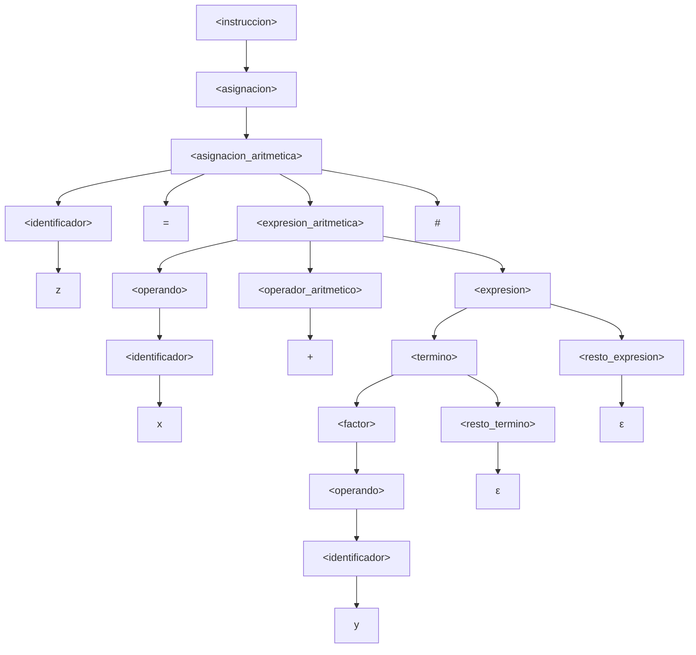

# Laboratorio 3 — Diseño y Validación de Gramáticas

**Asignatura:** Teoría de la Computación — INFO1148
**Tema:** Gramáticas Libres de Contexto (GLC)
**Modalidad:** Laboratorio práctico (parejas)
**Integrantes:** Francisco Benavides · _(integrante 2: completar)_
**Docente:** Prof. M. Lévano
**Puntaje:** 100 puntos

**Artefactos de este repositorio**

| Artefacto | Ruta |
|---|---|
| Gramática en BNF numerada | [`gramatica/Lab3_gramatica.bnf`](../gramatica/Lab3_gramatica.bnf) |
| Validador (léxico + sintáctico) | [`gramatica/gramatica.py`](../gramatica/gramatica.py) |
| Evidencia de validación | [`gramatica/salidas/validacion.txt`](../gramatica/salidas/validacion.txt) |
| Árbol de `z = x + y #` | [`gramatica/salidas/arbol_z_igual_x_mas_y.txt`](../gramatica/salidas/arbol_z_igual_x_mas_y.txt) · [`.dot`](../gramatica/salidas/arbol_z_igual_x_mas_y.dot) · [`.mmd`](../gramatica/salidas/arbol_z_igual_x_mas_y.mmd) |

---

## 0. Correspondencia con la rúbrica

| Criterio de la rúbrica | Máx. | Dónde se responde | Evidencia verificable |
|---|---|---|---|
| **P1.** Identificación formal | 20 | §3 | Tablas §3.1–§3.2, definición §3.4, argumento §3.5 |
| **P2.** Construcción de la GLC | 30 | §4 | Producciones P1–P41, justificación §4.1–§4.5, verificación §4.6 |
| **P3.** Derivaciones y árbol | 25 | §5 | Derivaciones izquierdas §5.2–§5.3, árbol §5.4, explicación §5.5 |
| **P4.** Validación y errores | 25 | §6 | Tabla §6.1, análisis por caso §6.2, ejecución §6.3 |
| Coherencia interna | — | §5.7, §6.3 | Todas las cadenas se validan con el **mismo** parser que implementa la gramática |
| Notación | — | §3.4, §5.1 | BNF numerado + convención explícita de derivación |
| Justificación | — | §4.5, §6.2, §7.6 | Cada producción y cada caso tiene su explicación |
| Extensión creativa | — | §7 | Opción A (condicional) formalizada en P7 y P34–P41 y validada |
| Presentación | — | Todo el documento | Tablas, árbol gráfico y transcripción de la ejecución |

> **Nota metodológica.** No se presentan producciones "sueltas": la gramática está implementada en un analizador
> léxico–sintáctico (`gramatica.py`) que reproduce exactamente las producciones de §3.4. Todas las derivaciones,
> el árbol y la tabla de validación son coherentes con ese código, y su ejecución se transcribe en §6.3.

---

## 1. Objetivo

Diseñar, analizar y validar una **Gramática Libre de Contexto (GLC)** que represente la estructura sintáctica
de un lenguaje de programación simplificado, identificando sus componentes (terminales, no terminales y símbolo
inicial), construyendo las producciones, realizando derivaciones por la izquierda y comprobando la pertenencia de
cadenas válidas e inválidas.

**Alcance del trabajo.** La gramática cubre: estructura de programa, asignación simple, asignación con expresión
aritmética (con precedencia entre `* / %` y `+ -`), instrucción de salida, una o más instrucciones por programa y
comentarios. Como **extensión creativa** (Opción A) se agrega el condicional `si … entonces … fin_si`.

---

## 2. Lenguaje de referencia

```text
Begin
Programa operativo_01_02

x = 1.345 #
y = 20 #

/* operaciones y salidas */

z = x + y #
z2 = x + y #
h = z - x #
h2 = z - x #
k = h * y #
t = k / z #
m = k % 10 #

salida z #
salida h #
salida k #
salida t #
salida m #

temporal = 0 #
temporal = x #
x = y #
y = temporal #

salida x #
salida y #

End
```

Observaciones que guían el diseño:

1. `Begin` … `End` delimitan el programa y encierran **una o más** instrucciones.
2. `Programa` va seguido de un identificador (`operativo_01_02`), que admite letras, dígitos y `_`.
3. Cada instrucción termina en `#`; el `#` es obligatorio también en la última instrucción antes de `End`.
4. Hay dos formas de asignación: con un solo operando (`x = 1.345 #`) y con una operación (`z = x + y #`).
5. La instrucción de salida siempre imprime un identificador (`salida z #`), nunca un literal.
6. Aparece un comentario `/* … */` entre instrucciones.

---

## 3. Pregunta 1 — Identificación formal de la gramática (20 puntos)

### 3.1 Símbolos terminales

El alfabeto de la gramática es **finito** y está formado por *lexemas fijos* y por *clases de token* (que
representan conjuntos infinitos de lexemas):

**Σ = {** `Begin`, `End`, `Programa`, `salida`, `si`, `entonces`, `fin_si`,
`+`, `-`, `*`, `/`, `%`, `<`, `>`, `<=`, `>=`, `==`, `!=`, `=`, `#`, `ID`, `NUM`, `COMENT` **}**

| Categoría | Terminales | Descripción / patrón | Origen |
|---|---|---|---|
| **Palabras reservadas** | `Begin`, `End`, `Programa`, `salida` | Delimitan programa y marcan instrucciones. Son sensibles a mayúsculas tal como aparecen en el enunciado (`Begin`, `End`, `Programa` con mayúscula; `salida` en minúscula). | Núcleo |
| **Palabras reservadas (extensión)** | `si`, `entonces`, `fin_si` | Delimitan el condicional de la Opción A. | Extensión |
| **Operadores aritméticos** | `+`, `-`, `*`, `/`, `%` | Operaciones binarias entre operandos. | Núcleo |
| **Operadores relacionales (extensión)** | `<`, `>`, `<=`, `>=`, `==`, `!=` | Comparaciones usadas en la condición del `si`. | Extensión |
| **Símbolos especiales** | `=` | Operador de **asignación**. | Núcleo |
| | `#` | **Terminador de instrucción** (obligatorio, incluso en la última instrucción). | Núcleo |
| **Identificadores** | `ID` | `letra (letra \| dígito \| "_")*`, es decir, comienza con letra y luego admite letras, dígitos y guion bajo. Ej.: `x`, `y`, `temporal`, `operativo_01_02`, `z2`. | Núcleo |
| **Números** | `NUM` | `dígito+ ( "." dígito+ )?` — enteros o reales **positivos**, sin signo y sin punto final. Ej.: `0`, `20`, `10`, `1.345`. | Núcleo |
| **Comentarios** | `COMENT` | `/* … */`, tratado como **un solo token** (ver §4.7 y Anexo A). | Núcleo |

**Convención léxica.** Los espacios, tabuladores y saltos de línea **no pertenecen** al lenguaje: el analizador
léxico los descarta antes de aplicar las producciones (por eso el programa de referencia puede estar escrito en
varias líneas). El espacio en blanco no se incluye en Σ porque no aporta estructura sintáctica.

### 3.2 Símbolos no terminales

| No terminal | Función |
|---|---|
| `<programa>` | Unidad sintáctica completa: `Begin Programa <id> <instrucciones> End`. |
| `<lista_instrucciones>` | Secuencia de **una o más** instrucciones, con comentarios intercalados. |
| `<instruccion>` | Cualquier instrucción: asignación, salida o (extensión) condicional. |
| `<asignacion>` | Punto de decisión entre asignación simple y aritmética. |
| `<asignacion_simple>` | `<id> = <operando> #` (un único valor a la derecha). |
| `<asignacion_aritmetica>` | `<id> = <expresión con al menos un operador> #`. |
| `<expresion_aritmetica>` | Expresión que **obliga** a que exista al menos una operación. |
| `<expresion>` | Expresión aditiva: términos separados por `+` o `-`. |
| `<resto_expresion>` | Cola recursiva de `<expresion>` (o ε). |
| `<termino>` | Expresión multiplicativa: factores separados por `*`, `/` o `%`. |
| `<resto_termino>` | Cola recursiva de `<termino>` (o ε). |
| `<factor>` | Unidad mínima de una expresión. |
| `<operando>` | Identificador o número. |
| `<operador_aritmetico>` | Agrupa los cinco operadores aritméticos. |
| `<salida>` | `salida <id> #`. |
| `<identificador>` | Enlace con la clase léxica `ID`. |
| `<numero>` | Enlace con la clase léxica `NUM`. |
| `<comentario>` | Enlace con la clase léxica `COMENT`. |
| `<condicional>` | (Extensión) `si <condición> entonces <instrucciones> fin_si`. |
| `<condicion>` | (Extensión) `<expresión> <op_relacional> <expresión>`. |
| `<operador_relacional>` | (Extensión) Agrupa los seis operadores relacionales. |

**V = {** `<programa>`, `<lista_instrucciones>`, `<instruccion>`, `<asignacion>`, `<asignacion_simple>`,
`<asignacion_aritmetica>`, `<expresion_aritmetica>`, `<expresion>`, `<resto_expresion>`, `<termino>`,
`<resto_termino>`, `<factor>`, `<operando>`, `<operador_aritmetico>`, `<salida>`, `<identificador>`, `<numero>`,
`<comentario>`, `<condicional>`, `<condicion>`, `<operador_relacional>` **}** → **|V| = 21**.

### 3.3 Símbolo inicial

**S = `<programa>`**. Es el único no terminal que produce un programa completo (desde `Begin` hasta `End`), por
lo que toda cadena del lenguaje debe derivarse a partir de él.

### 3.4 Definición formal de la gramática

> **G = (V, Σ, P, S)**, donde `V` y `Σ` son los conjuntos de §3.1 y §3.2, `S = <programa>` y `P` es el conjunto
> de las **41 producciones** que siguen (32 del núcleo + 9 de la extensión: P7 y P34–P41).

Notación: `ε` denota la producción vacía; cada producción se numera (`P#`) para referenciarla en las derivaciones.

| # | Producción | # | Producción |
|---|---|---|---|
| **P1** | `<programa> → Begin Programa <identificador> <lista_instrucciones> End` | **P22** | `<factor> → <operando>` |
| **P2** | `<lista_instrucciones> → <instruccion>` | **P23** | `<operando> → <identificador>` |
| **P3** | `<lista_instrucciones> → <instruccion> <lista_instrucciones>` | **P24** | `<operando> → <numero>` |
| **P4** | `<lista_instrucciones> → <comentario> <lista_instrucciones>` | **P25** | `<operador_aritmetico> → +` |
| **P5** | `<instruccion> → <asignacion>` | **P26** | `<operador_aritmetico> → -` |
| **P6** | `<instruccion> → <salida>` | **P27** | `<operador_aritmetico> → *` |
| **P7** | `<instruccion> → <condicional>` ⟵ *ext.* | **P28** | `<operador_aritmetico> → /` |
| **P8** | `<asignacion> → <asignacion_simple>` | **P29** | `<operador_aritmetico> → %` |
| **P9** | `<asignacion> → <asignacion_aritmetica>` | **P30** | `<salida> → salida <identificador> #` |
| **P10** | `<asignacion_simple> → <identificador> = <operando> #` | **P31** | `<identificador> → ID` |
| **P11** | `<asignacion_aritmetica> → <identificador> = <expresion_aritmetica> #` | **P32** | `<numero> → NUM` |
| **P12** | `<expresion_aritmetica> → <operando> <operador_aritmetico> <expresion>` | **P33** | `<comentario> → COMENT` |
| **P13** | `<expresion> → <termino> <resto_expresion>` | **P34** | `<condicional> → si <condicion> entonces <lista_instrucciones> fin_si` ⟵ *ext.* |
| **P14** | `<resto_expresion> → + <termino> <resto_expresion>` | **P35** | `<condicion> → <expresion> <operador_relacional> <expresion>` ⟵ *ext.* |
| **P15** | `<resto_expresion> → - <termino> <resto_expresion>` | **P36** | `<operador_relacional> → <` ⟵ *ext.* |
| **P16** | `<resto_expresion> → ε` | **P37** | `<operador_relacional> → >` ⟵ *ext.* |
| **P17** | `<termino> → <factor> <resto_termino>` | **P38** | `<operador_relacional> → <=` ⟵ *ext.* |
| **P18** | `<resto_termino> → * <factor> <resto_termino>` | **P39** | `<operador_relacional> → >=` ⟵ *ext.* |
| **P19** | `<resto_termino> → / <factor> <resto_termino>` | **P40** | `<operador_relacional> → ==` ⟵ *ext.* |
| **P20** | `<resto_termino> → % <factor> <resto_termino>` | **P41** | `<operador_relacional> → !=` ⟵ *ext.* |
| **P21** | `<resto_termino> → ε` | | |

La misma gramática, en formato BNF listo para copiar en otra herramienta, está en
[`gramatica/Lab3_gramatica.bnf`](../gramatica/Lab3_gramatica.bnf).

### 3.5 ¿Por qué no modelar identificadores y números enumerando cada valor?

Porque ambos conjuntos son **infinitos** y una gramática es un objeto **finito**:

1. **`P` sería infinita.** Habría que escribir `x → …`, `y → …`, `temporal → …`, `a1 → …`, para cada nombre
   posible; lo mismo con `0`, `1`, `2`, … y con todos los reales. Ninguna herramienta (ni JFLAP) podría almacenar
   ni procesar ese conjunto de producciones.
2. **No generaliza.** Un programa que use un identificador nuevo (`contador_02`) quedaría fuera del lenguaje
   aunque sea sintácticamente idéntico a uno ya enumerado: la gramática describiría una lista cerrada de
   programas, no un **lenguaje**.
3. **Separa responsabilidades.** Los identificadores y números se reconocen con reglas **regulares**
   (Anexo A): un autómata finito decide si una cadena de caracteres es `ID` o `NUM`. La GLC trabaja entonces
   sobre *tokens*, y cada clase (`ID`, `NUM`, `COMENT`) es **un** terminal. Así se mantiene Σ finito y `P` finito,
   que es justamente lo que exige la definición de gramática.
4. **Efecto práctico.** Gracias a esa abstracción, `x = 20 #` y `operativo_01_02 = 1.345 #` se derivan con las
   **mismas** producciones (P10, P23/P24, P31/P32); solo cambia el lexema asociado al token.

---

## 4. Pregunta 2 — Construcción de la GLC (30 puntos)

### 4.1 Estructura del programa (P1–P4)

```bnf
<programa>            → Begin Programa <identificador> <lista_instrucciones> End
<lista_instrucciones> → <instruccion>
                      | <instruccion> <lista_instrucciones>
                      | <comentario> <lista_instrucciones>
```

- **P1** fija el esqueleto exigido por el enunciado: `Begin Programa <id> <lista> End`. El identificador del
  programa es obligatorio (en el ejemplo, `operativo_01_02`).
- **P2/P3** garantizan **una o más** instrucciones: la recursión de P3 permite 1, 2, …, n instrucciones, y P2 es
  el caso base (por eso no se admite un programa vacío).
- **P4** permite intercalar comentarios (antes o entre instrucciones): el comentario se modela como un
  elemento más de la lista (P33), no como una instrucción. Como P4 vuelve a exigir una
  `<lista_instrucciones>` y la lista solo puede cerrarse con P2, todo comentario queda seguido por al menos
  una instrucción: se garantiza que el programa nunca quede sin instrucciones.

### 4.2 Asignación simple vs. asignación con expresión aritmética (P8–P12)

```bnf
<asignacion>            → <asignacion_simple> | <asignacion_aritmetica>
<asignacion_simple>     → <identificador> = <operando> #
<asignacion_aritmetica> → <identificador> = <expresion_aritmetica> #
<expresion_aritmetica>  → <operando> <operador_aritmetico> <expresion>
```

La diferencia es **estructural, no semántica**:

| Forma | Ejemplo | Producciones | Rasgo que la distingue |
|---|---|---|---|
| **Asignación simple** | `x = 20 #`, `temporal = x #` | P10 → P23/P24 | El lado derecho es **un solo operando**: no hay ningún operador aritmético. |
| **Asignación con expresión** | `z = x + y #`, `m = k % 10 #` | P11 → P12 → … | El lado derecho **contiene al menos un operador** (P12 exige `<operando> <op> <expresion>`). |

**¿Por qué no hay ambigüedad?** P12 obliga a que el primer operador aparezca inmediatamente después del primer
operando, y los operandos son átomos (`ID` o `NUM`), no expresiones. Por lo tanto la frontera entre
"simple" y "aritmética" es única: si tras `id = operando` hay un operador, se aplica P11; si hay `#`, se aplica P10.
Si se hubiera escrito en su lugar `<asignacion> → <id> = <expresion> #` con una expresión que admite un solo
operando, `x = 20 #` tendría **dos árboles** (uno por la vía simple y otro por la aritmética) y la gramática sería
ambigua. Por eso se separan las dos producciones.

### 4.3 Instrucción de salida (P30)

```bnf
<salida> → salida <identificador> #
```

`salida` imprime **solo identificadores** (`salida z #`), tal como muestra el programa de referencia; no se admite
`salida 20 #` ni `salida x + y #`. El `#` es obligatorio: `salida z` no es una instrucción.

### 4.4 Expresiones, precedencia y recursión (P13–P29)

La jerarquía `<expresion> → <termino> → <factor> → <operando>` codifica la **precedencia**:

```
        menor precedencia  ─────────────────────────►  mayor precedencia
   <expresion>  (+ -)   →   <termino>  (* / %)   →   <factor>   →   <operando>
```

- `+` y `-` se combinan en `<resto_expresion>` (P14–P16), que solo contiene términos.
- `*`, `/` y `%` se combinan en `<resto_termino>` (P18–P21), que solo contiene factores.
- Consecuencia: en `a + b * c` el `*` queda **más abajo** en el árbol (se evalúa primero), porque `b * c` se
  deriva dentro de un `<termino>`; mientras que en `a * b + c` la suma queda en la raíz de la expresión.
- Las producciones ε (P16, P21) son las que permiten que una expresión "termine": sin ellas la recursión nunca
  cerraría y solo se podrían generar cadenas infinitas.

> **Observación sobre asociatividad.** Al ser recursivas por la derecha, P14/P15 producen árboles
> `a - (b - c)` para `a - b - c`. El **lenguaje generado es el mismo** que con producciones recursivas por la
> izquierda (`<expresion> → <expresion> + <termino> | <expresion> - <termino> | <termino>`), que daría
> `(a - b) - c`. Se eligió la forma recursiva por la derecha porque las derivaciones por la izquierda son más
> legibles y el árbol es más fácil de dibujar; la asociatividad semántica no forma parte de lo evaluado en este
> laboratorio (el enunciado no incluye paréntesis ni evaluación).

### 4.5 Función de cada no terminal (justificación)

| No terminal | Por qué existe / qué aporta | Ejemplo que lo ejercita |
|---|---|---|
| `<programa>` | Aísla el esqueleto `Begin … End` y da un símbolo inicial único. | Programa completo. |
| `<lista_instrucciones>` | Resuelve "una o más instrucciones" con recursión (P2/P3) y admite comentarios (P4). | Las 21 líneas del ejemplo. |
| `<instruccion>` | Uniformiza el contenido de la lista y concentra la decisión entre las tres clases de instrucción (P5–P7). | `x = 1 #`, `salida x #`, `si …`. |
| `<asignacion>` | Separa la decisión simple/aritmética del resto (P8/P9). | `x = 1 #` vs. `x = 1 + 2 #`. |
| `<asignacion_simple>` | Reconoce asignaciones de un solo valor (P10). | `temporal = x #`. |
| `<asignacion_aritmetica>` | Reconoce asignaciones con operación (P11). | `z = x + y #`. |
| `<expresion_aritmetica>` | Obliga a que exista al menos un operador; sin ella no se podría distinguir la asignación simple. | `x + y`, `k % 10`. |
| `<expresion>` | Nivel aditivo: agrupa términos con `+`/`-`. | `z - x`. |
| `<resto_expresion>` | Recursión del nivel aditivo y caso base ε. | `x + y + z`. |
| `<termino>` | Nivel multiplicativo: agrupa factores con `*`, `/`, `%`. | `h * y`, `k / z`. |
| `<resto_termino>` | Recursión del nivel multiplicativo y caso base ε. | `a * b / c`. |
| `<factor>` | Unidad de la expresión; permite ampliar el lenguaje (p. ej. paréntesis) sin tocar los demás niveles. | `10`, `x`. |
| `<operando>` | Único punto donde se elige entre identificador y número (P23/P24). | `x`, `1.345`. |
| `<operador_aritmetico>` | Agrupa los cinco operadores en un solo no terminal (legibilidad y extensión). | `+`, `%`. |
| `<salida>` | Estructura propia de impresión (P30). | `salida z #`. |
| `<identificador>` | Enlace con el token `ID`; mantiene la gramática independiente de los lexemas concretos. | `operativo_01_02`. |
| `<numero>` | Enlace con el token `NUM` (enteros y reales). | `1.345`. |
| `<comentario>` | Enlace con el token `COMENT`; permite comentarios sin contaminar las instrucciones. | `/* … */`. |
| `<condicional>` | (Ext.) Estructura de control con condición y bloque propio. | `si x > 10 entonces … fin_si`. |
| `<condicion>` | (Ext.) Separa la condición del bloque para que sea reutilizable. | `x > 10`. |
| `<operador_relacional>` | (Ext.) Agrupa las seis comparaciones. | `>=`, `!=`. |

### 4.6 ¿La gramática representa el programa de referencia completo?

**Sí.** El programa de §2, con sus 20 instrucciones y su comentario, se deriva desde `<programa>` aplicando
P1, P3 (varias veces), P5/P9/P6, P2 (cierre de la lista) y P4 para el comentario. La verificación no es
declarativa: el validador lo procesa y responde **ACEPTADO**, contando los elementos reconocidos:

| Elemento del programa | Producción aplicada | Cantidad detectada |
|---|---|---|
| `Begin` … `End` con identificador | P1 + P31 | 1 programa (`operativo_01_02`) |
| Asignaciones simples (`x = 1.345 #`, `y = 20 #`, `temporal = 0 #`, `temporal = x #`, `x = y #`, `y = temporal #`) | P10, P23/P24 | **6** |
| Asignaciones aritméticas (`z`, `z2`, `h`, `h2`, `k`, `t`, `m`) | P11, P12 | **7** |
| Salidas (`z`, `h`, `k`, `t`, `m`, `x`, `y`) | P30 | **7** |
| Comentario `/* operaciones y salidas */` | P4, P33 | **1** |
| **Total de elementos de la lista** | P2/P3/P4 | **21** |

Los números coinciden con el programa: 20 instrucciones + 1 comentario = 21 elementos. Además, los números
`1.345` (real) y `20`, `0`, `10` (enteros) se aceptan con la misma clase `NUM` (P32), lo que confirma que no hace
falta enumerar valores.

### 4.7 Propiedades, alcance y limitaciones

1. **No ambigüedad (argumento estructural).** Cada nivel de la jerarquía tiene producciones disjuntas por su
   primer terminal: P10 empieza por `<identificador>` y solo puede continuar con `#` tras un operando; P12 obliga
   a un operador; P14/P15 se distinguen por `+`/`-`; P18–P20 por `*`/`/`/`%`. En `<lista_instrucciones>`, la
   alternativa se decide por el token (`ID`/`salida`/`si` vs. `COMENT`) y toda lista termina con P2. Por lo tanto
   cada cadena tiene un único árbol de derivación.
2. **Comentarios como token.** Un comentario puede contener cualquier carácter, incluso `Begin` o `#`.
   Modelarlo carácter por carácter exigiría producciones para todo el alfabeto y no aporta estructura
   sintáctica: se reconoce con la regla regular `COMENT` (Anexo A) y la GLC lo ve como un único símbolo
   terminal, igual que `ID` y `NUM`. Se admiten antes o entre instrucciones, pero no como **último**
   elemento de la lista: P4 obliga a que tras un comentario venga otra `<lista_instrucciones>`, que termina
   en una instrucción (P2). Es una decisión de diseño para no aceptar programas sin instrucciones; si se
   quisiera admitir un comentario final, bastaría agregar `<lista_instrucciones> → <comentario>` (o
   introducir un no terminal auxiliar para conservar la restricción).
3. **Sin paréntesis ni signos.** El lenguaje del enunciado no los incluye; por eso `<factor>` solo admite un
   operando. Añadirlos sería una extensión natural (`<factor> → ( <expresion> )`), pero cambiaría el lenguaje
   solicitado.
4. **Números positivos.** `-5` no es un `NUM`: el `-` es un operador binario. `1.` tampoco es válido (la parte
   decimal exige al menos un dígito), lo que el analizador léxico reporta como error.
5. **Mayúsculas.** Las palabras reservadas son sensibles a mayúsculas: `Begin`/`End`/`Programa` con mayúscula
   inicial y `salida` en minúscula, tal como aparecen en el enunciado. `begin` sería un identificador, no una
   palabra reservada.

---

## 5. Pregunta 3 — Derivaciones y árbol sintáctico (25 puntos)

### 5.1 Convención de notación

- `⇒` : una derivación en un paso (aplicación de **una** producción al no terminal **más a la izquierda**).
- `⇒*` : derivación en cero o más pasos.
- `ε` : cadena vacía; al final de una derivación no aporta símbolos a la forma sentencial.
- Para no inflar las tablas, la expansión de las clases léxicas se abrevia: `<identificador> ⇒ z` significa
  `<identificador> ⇒ ID ⇒ z` (P31 y reconocimiento léxico). El Anexo A muestra la expansión completa carácter por
  carácter de un identificador y de un número real.
- Se indica entre paréntesis la producción aplicada; los números remiten a la tabla de §3.4.

### 5.2 Derivación por la izquierda de `z = x + y #`

| Paso | Forma sentencial | Producción |
|---:|---|---|
| 0 | `<instruccion>` | — |
| 1 | `<asignacion>` | P5 |
| 2 | `<asignacion_aritmetica>` | P9 |
| 3 | `<identificador> = <expresion_aritmetica> #` | P11 |
| 4 | `z = <expresion_aritmetica> #` | P31 (léxica) |
| 5 | `z = <operando> <operador_aritmetico> <expresion> #` | P12 |
| 6 | `z = <identificador> <operador_aritmetico> <expresion> #` | P23 |
| 7 | `z = x <operador_aritmetico> <expresion> #` | P31 (léxica) |
| 8 | `z = x + <expresion> #` | P25 |
| 9 | `z = x + <termino> <resto_expresion> #` | P13 |
| 10 | `z = x + <factor> <resto_termino> <resto_expresion> #` | P17 |
| 11 | `z = x + <operando> <resto_termino> <resto_expresion> #` | P22 |
| 12 | `z = x + <identificador> <resto_termino> <resto_expresion> #` | P23 |
| 13 | `z = x + y <resto_termino> <resto_expresion> #` | P31 (léxica) |
| 14 | `z = x + y ε <resto_expresion> #` | P21 |
| 15 | `z = x + y ε ε #` | P16 |
| 16 | **`z = x + y #`** | ε no aporta símbolos |

Resultado: `<instruccion> ⇒* z = x + y #`. ✔

### 5.3 Derivación por la izquierda de `salida z #`

| Paso | Forma sentencial | Producción |
|---:|---|---|
| 0 | `<instruccion>` | — |
| 1 | `<salida>` | P6 |
| 2 | `salida <identificador> #` | P30 |
| 3 | **`salida z #`** | P31 (léxica) |

Resultado: `<instruccion> ⇒* salida z #`. ✔

### 5.4 Árbol de derivación de `z = x + y #`

Árbol generado automáticamente por el analizador (por lo tanto, **consistente con la gramática**). Puede
abrirse en cualquier visor de Mermaid o renderizarse desde
[`arbol_z_igual_x_mas_y.dot`](../gramatica/salidas/arbol_z_igual_x_mas_y.dot) con Graphviz; no se requiere JFLAP.



**Versión textual** (idéntica al archivo [`arbol_z_igual_x_mas_y.txt`](../gramatica/salidas/arbol_z_igual_x_mas_y.txt)):

```text
<instruccion>
└── <asignacion>
    └── <asignacion_aritmetica>
        ├── <identificador>
        │   └── z
        ├── =
        ├── <expresion_aritmetica>
        │   ├── <operando>
        │   │   └── <identificador>
        │   │       └── x
        │   ├── <operador_aritmetico>
        │   │   └── +
        │   └── <expresion>
        │       ├── <termino>
        │       │   ├── <factor>
        │       │   │   └── <operando>
        │       │   │       └── <identificador>
        │       │   │           └── y
        │       │   └── <resto_termino>
        │       │       └── ε
        │       └── <resto_expresion>
        │           └── ε
        └── #
```

### 5.5 Relación entre raíz, no terminales, terminales y hojas

- **Raíz:** es el símbolo inicial de la derivación, `<instruccion>` en este caso. Si el árbol se construye dentro
  de un programa completo, la raíz sería `<programa>` (el símbolo inicial `S` de la gramática). La raíz fija *qué*
  se está derivando; aquí se derivó una instrucción porque la cadena pedida es una instrucción suelta (§5.7
  muestra la derivación desde `<programa>`).
- **Nodos internos = no terminales:** cada nodo interno es un símbolo de `V` y corresponde a una producción
  aplicada. Por ejemplo, `<asignacion_aritmetica>` (n2) existe porque se aplicó P11: sus tres hijos sintácticos
  son `<identificador>`, `=` y `<expresion_aritmetica>` (más el `#`).
- **Hojas = terminales:** las hojas son símbolos de Σ (`z`, `=`, `x`, `+`, `y`, `#`) o ε. Leídas de izquierda a
  derecha reconstruyen **exactamente** la cadena derivada. La secuencia de hojas se denomina *fronda*:
  `z = x + y #`.
- **ε no se escribe:** los nodos `<resto_termino> → ε` y `<resto_expresion> → ε` son hojas que no aportan
  caracteres; están en el árbol porque explicitan que la recursión terminó (caso base).
- **Correspondencia con la derivación:** el árbol es la historia de la derivación. Cada nivel del árbol
  corresponde a un paso de §5.2, y el orden en que se expandieron los no terminales de izquierda a derecha es
  precisamente la derivación por la izquierda. La profundidad del árbol refleja la jerarquía de precedencia:
  `+` está por encima de `<termino>`, que es donde se alojarían `*`, `/` o `%`.

### 5.6 Pertenencia de las cadenas solicitadas

| Cadena | ¿Se genera? | Derivación (esquema) | Justificación |
|---|---|---|---|
| `x = 20 #` | **Sí** | `<instruccion> ⇒ <asignacion> ⇒ <asignacion_simple> ⇒ <identificador> = <operando> # ⇒ x = <numero> # ⇒ x = 20 #` (P5, P8, P10, P31, P24, P32) | El lado derecho es **un solo operando** (un número entero): se aplica la vía simple, no la aritmética. |
| `z = x * y #` | **Sí** | `<instruccion> ⇒ <asignacion> ⇒ <asignacion_aritmetica> ⇒ <id> = <expresion_aritmetica> # ⇒ z = <operando> <operador_aritmetico> <expresion> # ⇒ z = x * <expresion> # ⇒ z = x * y #` (P5, P9, P11, P31, P12, P23, P31, P27, P13, P17, P22, P23, P31, P21, P16) | `*` es uno de los cinco operadores de P27; la expresión se cierra con las producciones ε (P21, P16). |
| `salida temporal #` | **Sí** | `<instruccion> ⇒ <salida> ⇒ salida <identificador> # ⇒ salida temporal #` (P6, P30, P31) | `temporal` es un `ID` válido (letras y sin caracteres prohibidos); P30 no impone longitud al identificador. |

Las tres derivaciones fueron verificadas por el validador: las tres se aceptan (§6.3).

### 5.7 Coherencia con el símbolo inicial (derivación desde `<programa>`)

Para mostrar que la instrucción de §5.2 no es un caso aislado, se deriva el programa mínimo que la contiene,
`Begin Programa p z = x + y # End`:

```text
<programa>
⇒ Begin Programa <identificador> <lista_instrucciones> End        (P1)
⇒ Begin Programa p <lista_instrucciones> End                      (P31)
⇒ Begin Programa p <instruccion> End                              (P2)
⇒ Begin Programa p <asignacion> End                               (P5)
⇒ Begin Programa p <asignacion_aritmetica> End                    (P9)
⇒ Begin Programa p <identificador> = <expresion_aritmetica> # End (P11)
⇒ Begin Programa p z = <expresion_aritmetica> # End               (P31)
⇒ … (pasos 5–15 de §5.2) …
⇒ Begin Programa p z = x + y # End
```

Con P3 en lugar de P2, el mismo esquema produce programas con **varias** instrucciones, que es lo que exige el
programa de referencia.

---

## 6. Pregunta 4 — Validación y detección de errores (25 puntos)

### 6.1 Tabla de análisis

| Caso | Cadena | ¿Válida? | Token donde se detecta el problema | Elemento faltante o fuera de posición |
|---:|---|:---:|---|---|
| 1 | `x = 10 #` | **Sí** | — | — |
| 2 | `z = x + y #` | **Sí** | — | — |
| 3 | `salida z #` | **Sí** | — | — |
| 4 | `x 10 #` | **No** | `NUM` `10` (col. 3) | **Falta `=`** entre el identificador y el número (P10 exige `<identificador> = <operando> #`). |
| 5 | `z = + x y #` | **No** | `OP_ARIT` `+` (col. 5) | (i) El operador `+` está **al inicio de la expresión**: falta el operando de la izquierda (P12 exige `<operando> <op> <expresion>`). (ii) Aun corrigiendo (i), **falta un operador** entre `x` e `y`. |
| 6 | `salida #` | **No** | `HASH` `#` (col. 8) | **Falta el `<identificador>`** que se desea imprimir (P30 exige `salida <identificador> #`). |
| 7 | `x = 20` | **No** | `EOF` (col. 7) | **Falta el terminador `#`** al final de la instrucción (P10/P11). |
| 8 | `Begin / Programa prueba / x = 5 # / salida x # / End` | **Sí** | — | — (los `/` representan los saltos de línea; el espacio en blanco no pertenece a Σ). |

### 6.2 Análisis caso por caso

**Caso 1 — `x = 10 #` (válida).** Se deriva por la vía simple: `<asignacion_simple> ⇒ <identificador> = <operando> #`,
con `<operando> ⇒ <numero> ⇒ 10` (P10, P23, P24, P32). El `#` cierra la instrucción.

**Caso 2 — `z = x + y #` (válida).** Es la derivación de §5.2. El operador `+` obliga a la vía P11 (asignación
aritmética); el árbol está en §5.4.

**Caso 3 — `salida z #` (válida).** Derivación de §5.3. `salida` es palabra reservada (no un identificador) y el
identificador impreso es obligatorio.

**Caso 4 — `x 10 #` (inválida).** El parser consume el identificador `x` y, al aplicar P10, espera `=`; encuentra
`10` (`NUM`). El número está en el lugar donde debía ir el operador de asignación: **falta `=`**. No es un problema
de tipo ni de orden de los operandos, sino de un terminal obligatorio ausente.

**Caso 5 — `z = + x y #` (inválida).** Hay dos defectos:
1. P12 (`<operando> <operador_aritmetico> <expresion>`) exige que la expresión comience con un **operando**; el
   primer token tras `=` es `+`, es decir, el operador aparece **antes** de su operando izquierdo (el lenguaje no
   tiene operadores unarios, por lo que `+x` no existe).
2. Si se eliminara ese `+`, quedaría `z = x y #`: entre `x` e `y` no hay operador, y una expresión solo puede
   encadenar operandos a través de `<resto_expresion>` (P14/P15) o `<resto_termino>` (P18–P20). **Falta un
   operador** entre ambos identificadores.
El analizador reporta el primer defecto (posición col. 5) porque es el que aparece primero en la lectura.

**Caso 6 — `salida #` (inválida).** P30 exige `salida <identificador> #`; al consumir `salida` el siguiente token
debe ser un `ID`, pero es `#`. **Falta el identificador** de salida. (Imprimir un literal no está contemplado en
el lenguaje del enunciado.)

**Caso 7 — `x = 20` (inválida).** La asignación simple se deriva hasta `x = 20` y luego P10 exige `#`; la entrada
termina (`EOF`). **Falta el terminador de instrucción**. Este caso muestra por qué el `#` es un terminal y no un
separador opcional: sin él la instrucción queda incompleta, incluso si es la última del programa.

**Caso 8 — programa completo (válida).** La estructura es `Begin Programa prueba` + `<lista_de_instrucciones>` +
`End`. Aplicando P1, P3 (dos instrucciones) y P2, con `x = 5 #` por P10 y `salida x #` por P30, la cadena se
deriva por completo. Los `/` del enunciado son saltos de línea: el analizador léxico los descarta, por lo que no
afectan la validez. Nótese que `prueba` es un `ID` válido y que `x` se usa antes de asignarse: eso es un problema
**semántico**, no sintáctico, y la GLC no lo detecta (ni se le pide).

### 6.3 Evidencia de ejecución

Los resultados anteriores no son declarativos: se obtienen ejecutando el validador, que implementa exactamente
las producciones de §3.4.

```text
> python Lab3/gramatica/gramatica.py

PREGUNTA 2 - Programa de referencia completo
Resultado: ACEPTADO - Cadena valida
  - asignaciones simples      : 6
  - asignaciones aritmeticas  : 7
  - instrucciones de salida   : 7
  - comentarios               : 1
  - total de elementos        : 21

PREGUNTA 4 - Validacion de cadenas
Caso  Cadena                        Esperado   Obtenido   Estado
1     x = 10 #                      VALIDA     VALIDA     OK
2     z = x + y #                   VALIDA     VALIDA     OK
3     salida z #                    VALIDA     VALIDA     OK
4     x 10 #                        INVALIDA   INVALIDA   OK
      Analisis: se encontro NUM '10' ...; se esperaba: =
5     z = + x y #                   INVALIDA   INVALIDA   OK
      Analisis: se encontro OP_ARIT '+' ...; se esperaba: ID, NUM
6     salida #                      INVALIDA   INVALIDA   OK
      Analisis: se encontro HASH '#' ...; se esperaba: identificador
7     x = 20                        INVALIDA   INVALIDA   OK
      Analisis: se encontro EOF ...; se esperaba: #
8     Begin Programa prueba ...     VALIDA     VALIDA     OK

PREGUNTA 3 - Arbol de derivacion de 'z = x + y #'
Resultado: ACEPTADO - Cadena valida
Fronda (hojas de izquierda a derecha): z = x + y #

Fallos: 0
```

- Transcripción completa: [`gramatica/salidas/validacion.txt`](../gramatica/salidas/validacion.txt).
- Comprobación rápida (código de salida 0 si todo coincide): `python Lab3/gramatica/gramatica.py --check`.
- La columna **Estado** compara el resultado esperado con el obtenido; los ocho casos coinciden (`Fallos: 0`).

---

## 7. Extensión creativa — Opción A: condicional `si … entonces … fin_si`

### 7.1 Sintaxis propuesta

```text
si <condición> entonces
    <una o más instrucciones>
fin_si
```

- La **condición** es una comparación entre dos expresiones aritméticas, con operadores `<`, `>`, `<=`, `>=`,
  `==`, `!=`.
- El **cuerpo** usa la misma `<lista_instrucciones>` del núcleo, por lo que admite asignaciones, salidas, otras
  condiciones (anidamiento) y comentarios.
- El cierre `fin_si` es obligatorio (no hay forma de confundirlo con `End`, que cierra el programa).

**Ejemplo válido:**

```text
Begin
Programa control_01
x = 12 #
si x > 10 entonces
    salida x #
    y = x + 1 #
fin_si
salida y #
End
```

### 7.2 Modificación de la gramática

Se agregan **9 producciones** sin tocar las 32 del núcleo:

```bnf
<instruccion>     → … | <condicional>                                      (* P7  *)
<condicional>     → si <condicion> entonces <lista_instrucciones> fin_si   (* P34 *)
<condicion>       → <expresion> <operador_relacional> <expresion>          (* P35 *)
<operador_relacional> → < | > | <= | >= | == | !=                          (* P36–P41 *)
```

**¿Rompe la gramática existente?** No:

1. P7 agrega una alternativa a `<instruccion>`; las alternativas P5/P6 siguen siendo válidas para todo programa
   anterior (el lenguaje previo es un **subconjunto** del nuevo).
2. La condición reutiliza `<expresion>` (P13–P29), por lo que hereda precedencia y operandos sin duplicar reglas.
3. El cuerpo es una `<lista_instrucciones>` ya existente, lo que da **anidamiento** gratis:
   `si a > b entonces si c < d entonces x = 1 # fin_si fin_si` es válido.
4. No hay ambigüedad *dangling-else* porque no se incorporó `sino`: cada `si` tiene exactamente un `fin_si`.

### 7.3 Nuevos terminales y no terminales

| Tipo | Nuevos símbolos | Función |
|---|---|---|
| Terminales (palabras reservadas) | `si`, `entonces`, `fin_si` | Delimitan el condicional. |
| Terminales (operadores) | `<`, `>`, `<=`, `>=`, `==`, `!=` | Comparaciones de la condición. |
| No terminal | `<condicional>` | Estructura completa del condicional. |
| No terminal | `<condicion>` | Comparación entre dos expresiones. |
| No terminal | `<operador_relacional>` | Agrupa los seis operadores relacionales. |

> **Nota léxica:** `<` y `<=` (o `>` y `>=`) se distinguen por *maximal munch*: el analizador léxico consume
> siempre el operador más largo posible. `=` y `==` son tokens distintos (asignación vs. igualdad); el lexer
> reconoce `==` antes que `=`.

### 7.4 Cadena válida y cadena inválida

| Cadena | Resultado | Detalle |
|---|:---:|---|
| `si x > 10 entonces y = x + 1 # fin_si` | **Válida** | Condición `x > 10` (P35), cuerpo con una asignación aritmética (P9) y cierre `fin_si`. |
| `si x >= 10 entonces salida x # fin_si` | **Válida** | Usa un operador relacional de dos caracteres y una salida como cuerpo. |
| `si x > 10 entonces y = x + 1 #` | **Inválida** | **Falta `fin_si`**: al llegar al fin de la entrada el parser espera el cierre (P34). |
| `si entonces y = 1 # fin_si` | **Inválida** | **Falta la condición** entre `si` y `entonces` (P35 exige al menos un operando a cada lado). |

Ambas cadenas inválidas fueron verificadas con el validador, que reporta el token y lo que esperaba
(§6.3 / `validacion.txt`).

### 7.5 Derivación de ejemplo (por la izquierda)

Para `si x > 10 entonces y = x + 1 # fin_si`, desde `<instruccion>`:

| Paso | Forma sentencial | Producción |
|---:|---|---|
| 0 | `<instruccion>` | — |
| 1 | `<condicional>` | P7 |
| 2 | `si <condicion> entonces <lista_instrucciones> fin_si` | P34 |
| 3 | `si <expresion> <operador_relacional> <expresion> entonces <lista_instrucciones> fin_si` | P35 |
| 4 | `si <termino> <resto_expresion> <operador_relacional> <expresion> entonces …` | P13 |
| 5 | `si <factor> <resto_termino> <resto_expresion> <operador_relacional> <expresion> entonces …` | P17 |
| 6 | `si <operando> <resto_termino> <resto_expresion> <operador_relacional> <expresion> entonces …` | P22 |
| 7 | `si <identificador> <resto_termino> <resto_expresion> <operador_relacional> <expresion> entonces …` | P23 |
| 8 | `si x <resto_termino> <resto_expresion> <operador_relacional> <expresion> entonces …` | P31 |
| 9 | `si x ε ε <operador_relacional> <expresion> entonces …` | P21, P16 |
| 10 | `si x > <expresion> entonces …` | P37 |
| 11 | `si x > <termino> <resto_expresion> entonces …` | P13 |
| 12 | `si x > <factor> <resto_termino> <resto_expresion> entonces …` | P17 |
| 13 | `si x > <operando> <resto_termino> <resto_expresion> entonces …` | P22 |
| 14 | `si x > <numero> <resto_termino> <resto_expresion> entonces …` | P24 |
| 15 | `si x > 10 <resto_termino> <resto_expresion> entonces …` | P32 |
| 16 | `si x > 10 ε ε entonces <lista_instrucciones> fin_si` | P21, P16 |
| 17 | `si x > 10 entonces <lista_instrucciones> fin_si` | — |
| 18 | `si x > 10 entonces <instruccion> fin_si` | P2 |
| 19 | `si x > 10 entonces <asignacion> fin_si` | P5 |
| 20 | `si x > 10 entonces <asignacion_aritmetica> fin_si` | P9 |
| 21 | `si x > 10 entonces <identificador> = <expresion_aritmetica> # fin_si` | P11 |
| 22 | `si x > 10 entonces y = <expresion_aritmetica> # fin_si` | P31 |
| 23 | `si x > 10 entonces y = <operando> <operador_aritmetico> <expresion> # fin_si` | P12 |
| 24 | `si x > 10 entonces y = x + <expresion> # fin_si` | P23, P31, P25 |
| 25 | `si x > 10 entonces y = x + <termino> <resto_expresion> # fin_si` | P13 |
| 26 | `si x > 10 entonces y = x + <factor> <resto_termino> <resto_expresion> # fin_si` | P17 |
| 27 | `si x > 10 entonces y = x + <operando> <resto_termino> <resto_expresion> # fin_si` | P22 |
| 28 | `si x > 10 entonces y = x + <identificador> <resto_termino> <resto_expresion> # fin_si` | P23 |
| 29 | `si x > 10 entonces y = x + 1 <resto_termino> <resto_expresion> # fin_si` | P32 |
| 30 | `si x > 10 entonces y = x + 1 ε ε # fin_si` | P21, P16 |
| 31 | **`si x > 10 entonces y = x + 1 # fin_si`** | ε no aporta símbolos |

Los pasos 24–30 son exactamente la derivación de la asignación aritmética de §5.2: la extensión **reutiliza** la
gramática existente en lugar de duplicarla.

### 7.6 Justificación de la elección y alcance

Se eligió la **Opción A** porque:

1. Es la construcción de control más representativa de un lenguaje imperativo y la que mejor demuestra que la
   gramática es **extensible** (añadir 9 producciones habilita estructuras anidadas).
2. Obliga a introducir un nuevo nivel de decisión (`<condicional>` dentro de `<instruccion>`) y una nueva
   categoría de operadores (relacionales), lo que evidencia el manejo de precedencia y de tokens de dos
   caracteres.
3. Permite reutilizar `<lista_instrucciones>`, mostrando que el diseño del núcleo era modular.

**Limitaciones conscientes:** no se agregó `sino` (evita el problema *dangling-else* y mantiene la gramática no
ambigua), ni comparaciones encadenadas (`a < b < c`), ni operadores lógicos (`y`, `o`). Cualquiera de ellos podría
añadirse con el mismo patrón: nuevas producciones que reutilicen `<expresion>` y `<lista_instrucciones>`.

---

## 8. Conclusiones

1. **La formalización obliga a decidir.** Separar Σ (finito) de `V` y abstraer identificadores, números y
   comentarios como **clases de token** es lo que hace posible escribir una gramática finita para un lenguaje
   infinito (§3.5); enumerar valores sería imposible incluso para un subconjunto pequeño del programa de
   referencia.
2. **La gramática se valida con evidencia, no con afirmaciones.** El mismo conjunto de producciones se implementó
   como analizador: el programa de referencia se acepta completo (21 elementos), las tres cadenas de la P3 se
   derivan y los cinco casos inválidos de la P4 se rechazan indicando el token y el terminal esperado (§6.3).
3. **La distinción simple/aritmética requiere diseño.** Si ambas formas compartieran una única producción con una
   expresión que admite un solo operando, la gramática sería ambigua; P10/P11 + P12 resuelven el problema por
   estructura y no por contexto (§4.2).
4. **Precedencia sin ambigüedad.** La jerarquía `<expresion> → <termino> → <factor> → <operando>` codifica la
   precedencia de los cinco operadores y deja el árbol alineado con la semántica esperada (§4.4, §5.5).
5. **La extensión no rompe lo anterior.** El condicional se incorporó con 9 producciones que reutilizan
   `<expresion>` y `<lista_instrucciones>`; el lenguaje previo queda como subconjunto del nuevo (§7.2).
6. **Sintaxis ≠ semántica.** `Begin Programa prueba x = 5 # salida y # End` es sintácticamente válido aunque `y`
   no esté definida; detectar eso requiere análisis semántico, fuera del alcance de una GLC (§6.2, caso 8).

---

## 9. Referencias

- Enunciado y rúbrica del Laboratorio 3 — Diseño y Validación de Gramáticas, INFO1148.
- Hopcroft, J.; Motwani, R.; Ullman, J. *Introducción a la Teoría de Autómatas, Lenguajes y Computación*.
  Capítulos 5 (gramáticas libres de contexto) y 2 (lenguajes regulares / análisis léxico).
- Aho, A.; Lam, M.; Sethi, R.; Ullman, J. *Compiladores: principios, técnicas y herramientas*. Capítulos 2–4
  (análisis léxico, sintáctico y gramáticas).
- Documentación de JFLAP (gramáticas libres de contexto), por si se desea cargar la gramática en la herramienta:
  <https://www.jflap.org/>.

---

## Anexo A — Nivel léxico (definición de `ID`, `NUM` y `COMENT`)

Las tres clases de token se definen con reglas regulares (equivalentes a autómatas finitos), lo que justifica
tratarlas como **un solo terminal** en la GLC:

| Token | Expresión regular | Ejemplos válidos | Ejemplos inválidos |
|---|---|---|---|
| `ID` | `[a-zA-Z] [a-zA-Z0-9_]*` | `x`, `z2`, `temporal`, `operativo_01_02` | `2x`, `_tmp`, `a-b` |
| `NUM` | `[0-9]+ ( "." [0-9]+ )?` | `0`, `20`, `10`, `1.345` | `.5`, `1.`, `-4` |
| `COMENT` | `/\* ([^*] \| \*+ [^*/] )* \*+/` | `/* operaciones y salidas */` | `/* sin cerrar` |

**Derivación a nivel de caracteres** (expansión completa de la abreviatura usada en §5, con una gramática léxica
equivalente):

```text
<identificador> ⇒ <letra> <resto_id>                  (id → letra resto)
                ⇒ z <resto_id>                        (letra → z)
                ⇒ z ε                                 (resto_id → ε)

<numero> ⇒ <entero> <parte_decimal>                   (num → entero parte_decimal)
         ⇒ <digito> <resto_entero> <parte_decimal>    (entero → digito resto_entero)
         ⇒ 1 <resto_entero> <parte_decimal>           (digito → 1)
         ⇒ 1 ε <parte_decimal>                        (resto_entero → ε)
         ⇒ 1 . <digito> <resto_entero>                (parte_decimal → . digito resto_entero)
         ⇒ 1 . 3 <resto_entero>                       (digito → 3)
         ⇒ 1 . 3 4 <resto_entero>                     (resto_entero → digito resto_entero)
         ⇒ 1 . 3 4 5 <resto_entero>                   (resto_entero → digito resto_entero)
         ⇒ 1 . 3 4 5 ε                                (resto_entero → ε)
```

Reglas utilizadas: `<letra> → a | … | z | A | … | Z`; `<digito> → 0 | … | 9`;
`<resto_id> → <letra> <resto_id> | <digito> <resto_id> | _ <resto_id> | ε`;
`<resto_entero> → <digito> <resto_entero> | ε`; `<parte_decimal> → . <digito> <resto_entero> | ε` (por eso `1.`
no es válido: el punto exige al menos un dígito).

---

## Anexo B — Reproducibilidad

```bash
# Validar todo (programa de referencia, tabla de la P4 y extensión)
python Lab3/gramatica/gramatica.py

# Solo comprobación rápida (código de salida 0 = todo coincide)
python Lab3/gramatica/gramatica.py --check
```

| Archivo generado | Contenido |
|---|---|
| `gramatica/salidas/validacion.txt` | Transcripción completa de la ejecución. |
| `gramatica/salidas/arbol_z_igual_x_mas_y.txt` | Árbol de `z = x + y #` en texto. |
| `gramatica/salidas/arbol_z_igual_x_mas_y.dot` | Árbol en formato Graphviz (renderizable con `dot -Tpng`). |
| `gramatica/salidas/arbol_z_igual_x_mas_y.mmd` | Árbol en Mermaid. |
| `gramatica/salidas/arbol_programa_referencia.dot` | Árbol del programa de referencia completo. |

Requisitos: Python 3.9 o superior, sin dependencias externas (solo biblioteca estándar).

---

## Anexo C — Autoevaluación con la rúbrica

| Criterio (nivel "Excelente") | ¿Se cumple? | Dónde |
|---|:---:|---|
| P1: identifica terminales, no terminales, símbolo inicial y define `G=(V,Σ,P,S)` con precisión + explicación conceptual clara | ✔ | §3.1–§3.5 |
| P1: explica por qué no enumerar identificadores y números | ✔ | §3.5 |
| P2: gramática correcta, representa todas las estructuras y permite múltiples instrucciones; producciones claras y justificadas | ✔ | §4.1–§4.6 |
| P2: diferencia asignación simple, aritmética y salida | ✔ | §4.2–§4.3 |
| P2: verifica el programa de referencia completo | ✔ | §4.6 (+ ejecución §6.3) |
| P3: derivaciones por la izquierda completas y correctas | ✔ | §5.2, §5.3, §5.7, §7.5 |
| P3: árbol consistente + explicación nodos/símbolos/hojas | ✔ | §5.4–§5.5 |
| P3: decide pertenencia de las tres cadenas y justifica | ✔ | §5.6 |
| P4: clasifica las 8 cadenas, justifica y detecta elementos faltantes o mal ubicados | ✔ | §6.1–§6.2 |
| Transversal: coherencia interna (derivaciones, árbol y validaciones corresponden a la gramática) | ✔ | Todo se genera desde `gramatica.py` |
| Transversal: notación consistente | ✔ | §3.4 (P1–P41), §5.1 |
| Transversal: extensión creativa formalizada y evaluada | ✔ | §7 |
| Transversal: presentación legible | ✔ | Tablas, árbol gráfico y transcripción |
